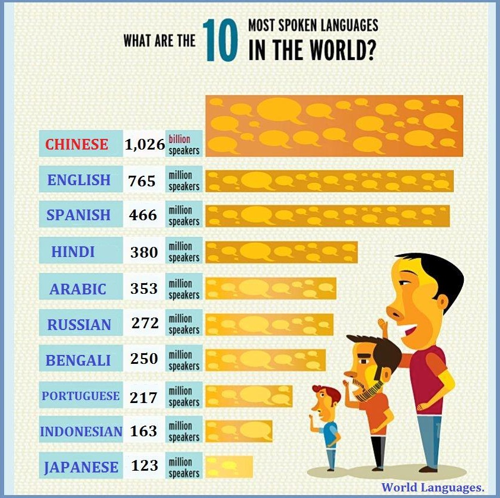
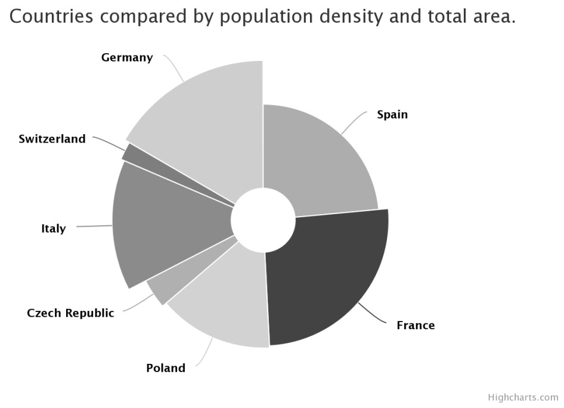
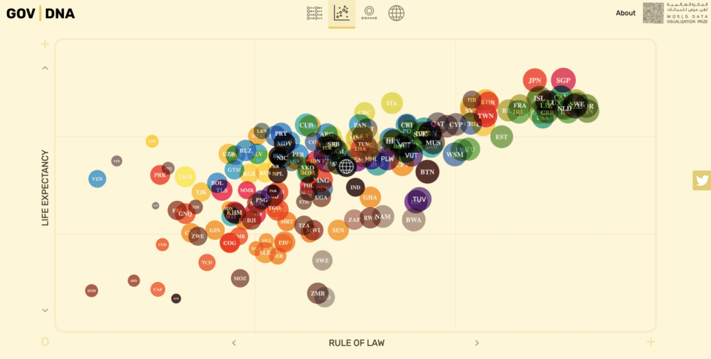
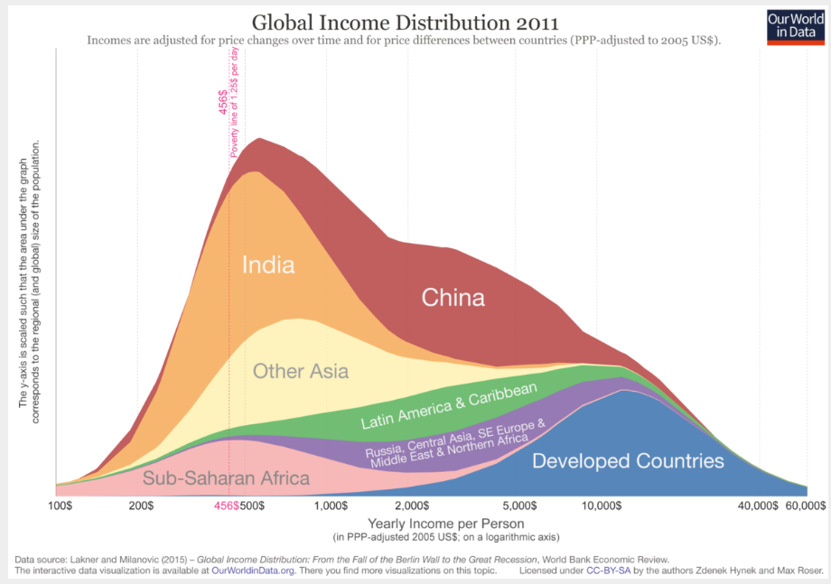

### Load packages

```{r load-packages, warning = FALSE, message = FALSE, warning=FALSE}
library(tidyverse)
library(ggplot2)
```

# Questioning data visualisations

## Image 1

```{r echo=FALSE, out.width="80%"}

```

* Respect the people: How should the comma in "1,026" be interpreted? As a thousands place seporator (ie one thousand and twenty six) or as a decimal place seporator (ie one and twenty-six thousands)? As the text states "billion" speakers then it is unlikely to be 1026 billion (ie about 1 trillion) as there are only about 8 billion people in the world.

* Respect the mathematics: The geometry relationship of the boxes do not correspond to the numbers. For example, based on the numbers there are about 65% more english speakers than spanish speakers, but the length of the boxes appear to be the same. Furthermore, it is unclear what aspect of the box geometry relates to the number of speakers - length, width or area?


## Image 2

```{r echo=FALSE, out.width="80%"}

```


* Respect the people: The image is in grayscale, so the shaded color for Switzerland and Italy are difficult to distinguish if it wasn't for the text. If it was not possible to add colour to the image (due to printing constraints) then we may consider different shading patterns (cross-hash, lines, dots, etc.) or consider a different data visualisation.

* Respect the data: There are no values or axes! As such it is difficult to assess the relationshiop between the countries

* Respect the mathematics: The title states the two variables of 'population density' and 'total area', but it is unclear how each variable is mapped to each component of the rose chart -- the radius distance, the angle propotion, the segment area?


## Image 3

```{r echo=FALSE, out.width="80%"}

```

_Write your comments about image 3 below_

* Respect the people: Who is this data visualisation created for and what are they wanting to undersand from the image. If they wish to understand the overall relationship (ie positive linear correlation) then this visualisation is ok, but if they want to explore the life expectancy vs rule of law relationship in certain regions of the world (ie compare one colour against another) then the image may be difficult to interpret.

* Respect the data: There are no values on the axes! Also, how is 'Rule of Law' measured? Furthermore, some of the points are different sizes and it is unknow what this aesthetic variable relates to.

* Respect the computer: Many of the points are overlapping and so the author of the data visualisation has chosen to make the points partially transparent to aid identifying points that intesect. However, since the points are different colours the impact of the transparency results in a different colour when point intersect - for example, the intersection if a yellow and a blue point has a green appearance, but the green colour is used by other points.


## Image 4

```{r echo=FALSE, out.width="80%"}

```

_Write your comments about image 4 below_


* Respect the people: Althougth the data visualisation is correct, the design choice to partition the area under the density curve for each region may make the image difficult to comprehend. For example, is the "Other Asian" proportion at \$750 yearly income bigger or smaller than the "China" proportion at \$3000 yearly income? The issue here is that there does not exisit a consistent baseline - a sequence of individual density plot would be better for assessing this question.

* Respect the data: There are no values on the y-axis. Also, the ends of the density plot does not touch the x-axis, which indicates that the visualisation has been truncated to be between \$100 and \$60,000 - are there any outliers in the data that may be interesting to examine closely?

# Data Visualization for Halloween

## Exercise 1

```{r}
# Necessary packages
library(tidyverse)
library(ggplot2)

# Install that package first 
# install.packages("fivethirtyeight")
library(fivethirtyeight)
```


```{r}
candy_df <- candy_rankings
glimpse(candy_df)
```


How many observations and variables are in this dataset?
Did you identify the type of variables, remember that this detail is crucial to create which kind of data visualization in general. 

- We have 85 rows and 13 columns here, each row is one candy, and each column is one fact about that candy. 

- The three numerical variables are measured on different scales; others are some logical values about the candy characteristics, that can be converted into factorial ones later.

To get the same information via `glimpse()`, you can also use the commands below for a quick verification:

```{r}
nrow(candy_df) # number of rows in the data frame
ncol(candy_df) # number of columns in the data frame
dim(candy_df) # both number of rows and columns for data frame
```

## Exercise 2

Complete the following code to get the data viz to represent "how many candies contain caramel via bar plot". Fill in the blanks, remove the # symbol in front of your code and the execute the code chunk via green play button.

```{r}
ggplot(candy_df, aes(x = caramel)) +
  geom_bar()
```

-In general, the candies that does not contain caramel seems larger based on the proportion of false vs true values represented above. 

- How many candies contain chocolate? Make a bar plot of chocolate. 
Include x and y labels and a title.

```{r}
ggplot(candy_df, aes(x = chocolate)) +
  geom_bar() +
  labs(
    title = "Most candies in the data do not contain chocolate",
    x = "Contains chocolate?",
    y = "Number of candies"
  )
```

Same sort of pattern here, but the difference is less compared to caramel case we observed. 

## Exercise 3

Now look at a numerical variable, such as `winpercent`. Create an histogram for this variable using ggplot2 functions below. Include informative x and y labels and a title.

```{r}
ggplot(candy_df, aes(x = winpercent)) +
  geom_histogram() +
  labs(
    title = "Distribution of head-to-head win percentages",
    x = "Win percentage (%)",
    y = "Number of candies"
  )
```

- Not easy to say, probably changing bandwith or bins can be useful for the general shape discussion. It seems that there are different peak points, not seems like a symmetric style shape of distrubution. 
- Play with the binwidth parameter in the new version by using `binwidth = 5`. How this effects the result ? 

```{r}
ggplot(candy_df, aes(x = winpercent)) +
  geom_histogram(binwidth = 5) +
  labs(
    title = "Distribution of head-to-head win percentages",
    x = "Win percentage (%)",
    y = "Number of candies"
  )
```

## Exercise 4

How about using the both variables; chocolate vs winpercent? Run the following incomplete code snippet to get a faceted visualization.

Fill in the blanks, remove the # symbol in front of your code and the execute the code chunk via green play button.

```{r}
# Your code here
ggplot(candy_df, aes(x = winpercent)) +
  geom_histogram(binwidth = 5) +
  facet_wrap(~chocolate)
```

- Consider adding the `fill = caramel` within the aes() vs. geom_histogram(), what do you get? 

```{r}
# Adding the fill 
ggplot(candy_df, aes(x = winpercent, fill = caramel)) +
  geom_histogram(binwidth = 5) +
  facet_wrap(~chocolate)
```

This works and create a separated histograms overlayed above. But addin this argument to geom_histogram() here does not create a real visualization 

```{r, eval=FALSE}
# Adding the fill 
ggplot(candy_df, aes(x = winpercent)) +
  geom_histogram(binwidth = 5, fill = caramel) +
  facet_wrap(~chocolate)
```

We need to make fix values instead, such as fixed color here creates histogram with different colors. 

```{r}
# Adding the fill 
ggplot(candy_df, aes(x = winpercent)) +
  geom_histogram(binwidth = 5, fill = 3) +
  facet_wrap(~chocolate)
```

## Exercise 5

Create a visualization that examines the relationship between a candy’s win percentage and whether it contains chocolate. Include x and y labels and a title. Describe any relationship you see.

```{r}
ggplot(candy_rankings, aes(x = chocolate, y = winpercent)) +
  geom_boxplot() +
  labs(
    title = "Chocolate candies win more head-to-head matchups",
    x = "Contains chocolate?",
    y = "Win percentage (%)"
  )
```

- Consider the similar pair by replacing chocolate with caramel, fruity and compare their results. 

```{r}
ggplot(candy_rankings, aes(x = fruity, y = winpercent, fill = fruity)) +
  geom_boxplot() +
  labs(
    title = "Chocolate candies win more head-to-head matchups",
    x = "Contains chocolate?",
    y = "Win percentage (%)"
  )
```

Combine both together here

```{r}
ggplot(candy_rankings, aes(x = fruity, y = winpercent, fill = caramel)) +
  geom_boxplot() +
  labs(
    title = "Chocolate candies win more head-to-head matchups",
    x = "Contains chocolate?",
    y = "Win percentage (%)"
  )
```

For the summary statistics, this can be a starting point, look at other types also by replacing the chocolate

```{r}
candy_rankings %>%
  group_by(chocolate) %>%
  summarise(
    n = n(),
    mean_win = mean(winpercent),
    median_win = median(winpercent)
  )
```

## Exercise 6

Do more expensive candies win more often? Make a scatterplot of pricepercent (x) against winpercent (y). Describe their relationship.  

```{r}
ggplot(candy_df, aes(x = pricepercent, y = winpercent)) +
  geom_point() +
  labs(
    title = "Pricier candies win slightly more often",
    x = "Price percentile (0 = cheapest, 1 = most expensive)",
    y = "Win percentage (%)"
  )
```

No specific pattern on scatter plot overall, whereas certain groupings appeared for candies having chocolate or not based on price and win percentage. 

- Add `color = chocolate` to add a third variable to the created visualization

```{r}
ggplot(candy_df, aes(x = pricepercent, y = winpercent, color = chocolate)) +
  geom_point() +
  labs(
    title = "Pricier candies over chocolate type",
    x = "Price percentile (0 = cheapest, 1 = most expensive)",
    y = "Win percentage (%)"
  )
```


No specific pattern on scatter plot overall, whereas certain groupings appeared for candies having chocolate or not based on price and win percentage. 

- How to facet this by using another categorical variable such as `bar`? 

```{r}
ggplot(candy_df, aes(x = pricepercent, y = winpercent, color = chocolate)) +
  geom_point() +
  facet_grid(~ bar) + 
  labs(
    title = "Pricier candies over chocolate type and bar categories",
    x = "Price percentile (0 = cheapest, 1 = most expensive)",
    y = "Win percentage (%)"
  )
```

For the bar separation on the right, it seems only one case do not include chocolate, the left panel is more diverse regarding the chocolate information 

## Exercise 7

Are chocolate candies more likely to be candy bars? Make a filled bar plot with chocolate on the x-axis and `fill = bar`. Describe what you see.

```{r}
ggplot(candy_df, aes(x = chocolate, fill = bar)) +
  geom_bar(position = "fill") +
  labs(
    title = "About half of chocolate candies are bars",
    x = "Contains chocolate?",
    y = "Proportion of candies",
    fill = "Candy bar?"
  )
```

About half of chocolate candies are bars, this is not the case for the ones that are not chocolate candies, only few seems candy bar. 

## Exercise 8

Create a new variable called price per sugar ratio as the division of pricepercent and sugarpercent. Plot it against winpercent, and set the color of all points to blue for the competitors who are not "One dime" or "One quarter". Include x and y labels and a title. Describe any relationship you see.

```{r}
candy_rankings <- candy_rankings %>%
  mutate(price_per_sugar = pricepercent / sugarpercent)

candy_rankings %>%
  filter(!competitorname %in% c("One dime", "One quarter")) %>%
  ggplot(aes(x = price_per_sugar, y = winpercent)) +
  geom_point(color = "blue") +
  labs(
    title = "Price per sugar is not linked to win percentage",
    x = "Price per sugar (price percentile / sugar percentile)",
    y = "Win percentage (%)"
  )
```

## Exercise 9

Modify your plot in Exercise 8 to facet by whether a candy is bar-shaped. Have the color reflect whether the candy is fruity or not. The plot must include x and y labels along with a title. How do these plots compare to each other?

```{r}
ggplot(candy_rankings, aes(x = price_per_sugar, y = winpercent, color = fruity)) +
  geom_point() +
  facet_wrap(~ bar, labeller = label_both) +
  labs(
    title = "Candy bars win more often, and none of them are fruity",
    x = "Price-sugar index",
    y = "Win percentage (%)",
    color = "Fruity?"
  )
```


--- 

# Take a sad plot and make it better!

```{r load-data-staff, message=FALSE, eval=TRUE}
staff <- read_csv("data/instructional-staff.csv")
```


## Exercise 1

A *wide* data set is where each row and column relate to a unique case with the data value appearing in a single cell.

A *long* data set is where each row of the data set corresponds to a unique observation.

The `staff` data set is in a *wide* format

There are 11 years and 5 faculty types,  so there are `11 * 5 = 55` observations in the data set.


## Exercise 2

```{r pivoting}
staff_long <- staff %>%
  pivot_longer(
    cols = c("1975", "1989", "1993", "1995", "1999", "2001", 
             "2003", "2005", "2007", "2009" ,"2011"), 
    names_to = "year",
    values_to = "percent"
  )

```


## Exercise 3

```{r dot-plot}
ggplot(data = staff_long,
       mapping = aes(x = year, 
                     y = percent, 
                     colour = faculty_type)) +
  geom_point()
```

## Exercise 4

```{r bad-line-plot}
ggplot(data = staff_long,
       mapping = aes(x = year, 
                     y = percent, 
                     colour = faculty_type)) +
  geom_line()
```

Note that the lines in this plot do not appear! This is because the type of variable `year` is character.

## Exercise 5

```{r mutate-year}
staff_long <- staff_long %>%
  mutate(year = as.numeric(year))
```


```{r working-line-plot}
ggplot(data = staff_long,
       mapping = aes(x = year, 
                     y = percent, 
                     colour = faculty_type)) +
  geom_line()
```

This time the data visualisation works!

## Exercise 6

```{r better-line-plot}
# Write your code for Exercise 6 here


ggplot(data = staff_long,
       mapping = aes(x = year, 
                     y = percent, 
                     colour = faculty_type)) +
  geom_line() +
  labs(
    title = "Instructional staff employment trends, 1975–2011",
    x = "Year",
    y = "Percentage",
    colour = "Faculty Type",
    caption = "Data source: American Association of University Professors"
  )

```

## Exercise 7

(e.g.) Change colours to highlight---other options are possible here!

(NB. The "correct" answer to this section will depend on the ideas generated in Exercise 7. The code below shows one example as to how you may implement the idea given above.)

```{r implement-Ex7}
#Edit staff_long to create a new variable that 
#   identifies if the row relates to part-time or other
staff_long <- staff_long %>%
  mutate(part_time = 
           case_when(
             faculty_type == "Part-Time Faculty" ~ "Part-Time Faculty",
             TRUE ~ "Other Faculty Types"))

ggplot(data = staff_long,
       mapping = aes(x = year, 
                     y = percent, 
                     group = faculty_type,  
                        # to draw seporate lines per faculty type
                     colour = part_time  
                        # to colour the lines using the new part_time variable
       ))+
  geom_line() +
  scale_colour_manual(values = c("gray", "red")) +
  theme_minimal() +
  labs(
    title = "Instructional staff employment trends, 1975–2011",
    x = "Year",
    y = "Percentage",
    colour = "",
    caption = "Data source: American Association of University Professors"
  ) +
  coord_cartesian(ylim = c(0, 45)) + 
  theme(legend.position = "bottom")
```


