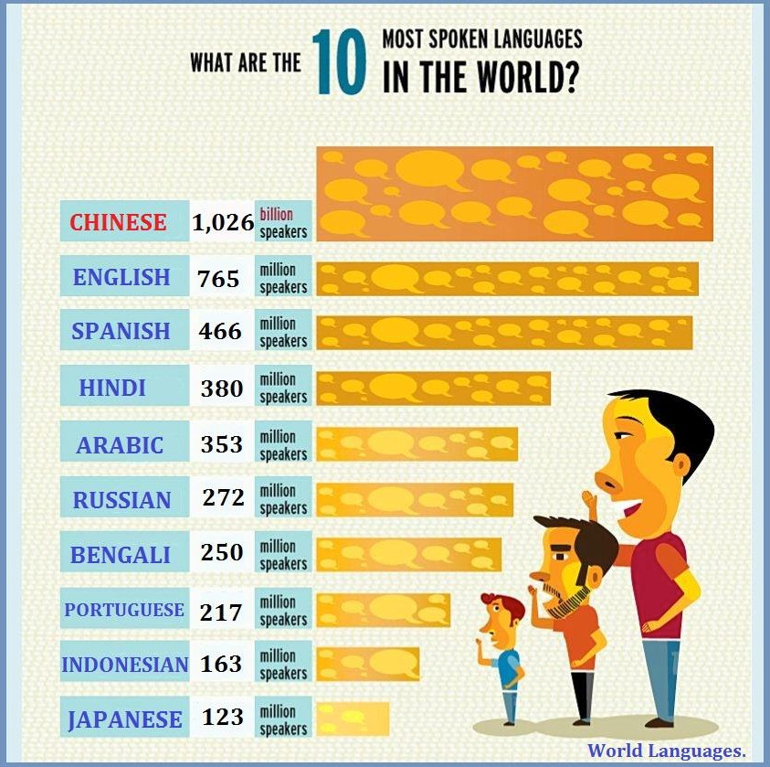
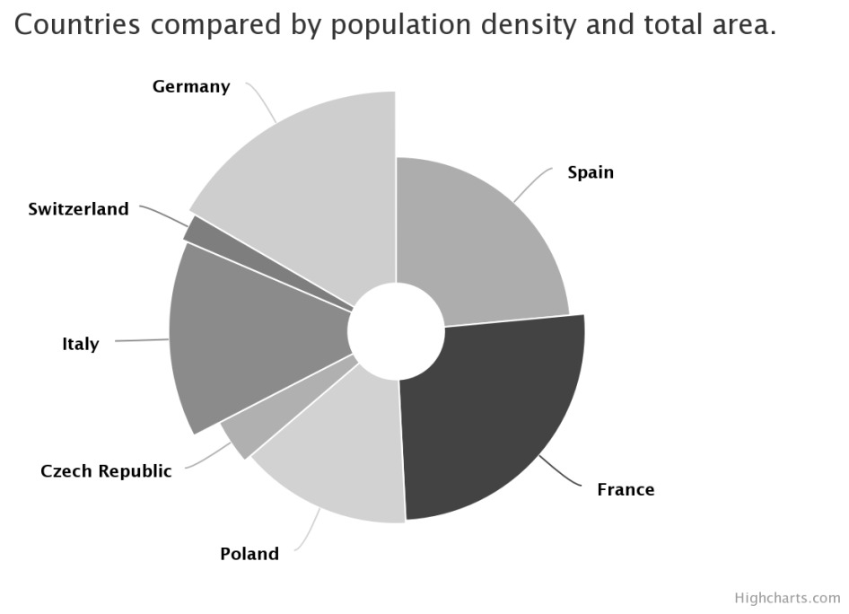
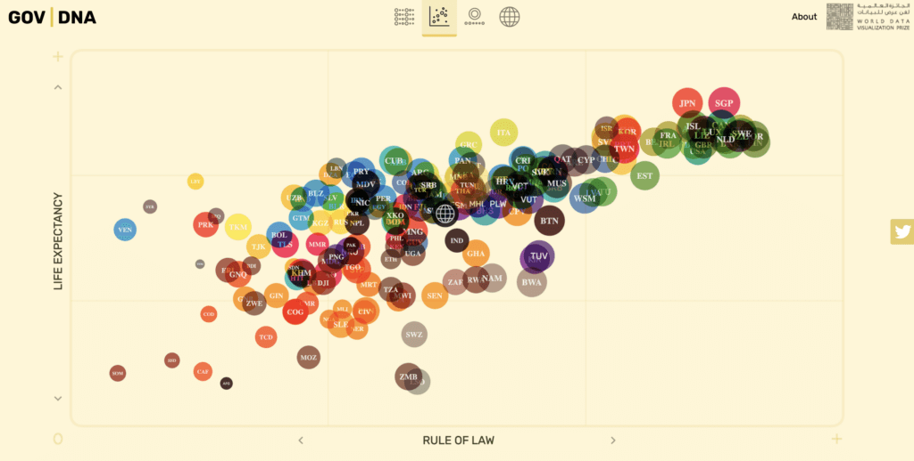
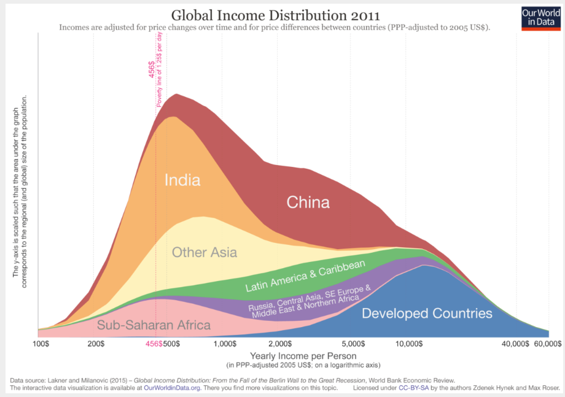
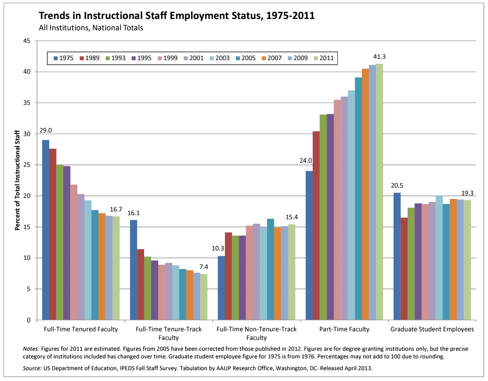

```{r setup, include=FALSE}
knitr::opts_chunk$set(eval = TRUE)
```


```{r unsplash, fig.margin = TRUE, echo = FALSE, eval = TRUE, fig.cap = "Image by Maven Halloween Challenge"}
knitr::include_graphics("img/spooky-dataviz.avif")
```

In this lab you will discuss in your groups what makes a good data visualisation and create a better visualisation for the above data. You will also explore two different data sets for specific tasks to sharpen your data viz skills. 

Two data sets to explore:

- 	The Ultimate Halloween Candy Power Ranking - *candy_rankings* data comes from the _fivethirtyeight_ R package

- American Association of University Professors (AAUP) data set as *instructional-staff.csv* file to import 

# Learning goals

-   Discuss the qualities of data visualisation.
-   Create data visualisations on different data sets
-   Working collaboratively via GitHub and recall how to resolve merge conflicts, if that happens.


-----------------------------------------------------------------------

# Set-up

🚘🚘 Please find your team members that you formed in previous workshops. You are definitely encouraged to discuss the questions with the rest of your team, but feel free to work on individual repositories if you prefer.

In the following:

- if you want to keep working in pairs or teams, create a shared repository and invite your team members as collaborators (see instructions from previous workshops);

- if you prefer to work individually, then each of you should create your own repository by cloning the template as described below. 


## Instructions to clone repository & create a vesion control project

Log onto GitHub and create a new repository by cloning  today's lab template project. To remind you of the step:

* Go to *Your repositories* in your GitHub account and then click on the green *New* button.
* Click on *Import a repository* and type/copy the URL of today's lab template project: [https://github.com/uoeIDS/lab-06-template](https://github.com/uoeIDS/lab-06-template)
* Add an appropriate name to your repository, say `lab-06`, and click on *Begin import*.
    
As always, open RStudio and create a new version control project using the GitHub repository you have just made. To remind you of the steps:

- Open *RStudio* and go to *File* > *New Project...* 
- Select *Version Control* and then *Git*. Type/paste the URL of the repository you have just created. 
- Browse an appropriate location for the project and then click on *Create Project*.

Open the R Markdown document `lab-06.Rmd` and change the author to your name. *Knit* the document and make sure that it complies correctly without any errors.

`r emoji::emoji("white_check_mark")` `r emoji::emoji("arrow_up")` Commit and push your changes to GitHub with an appropriate commit message. Remember do good version control practices by periodically keeping your repository on GitHub up-to-date by staging and committing any substantial changes, and then push them to GitHub.

-----

# Discussion: Questioning data visualisations

Look at the following data visualisations. Have a discussion with your team members at what might be problematic with the images. Do any of the visualisations have a problem with the 4 respects -- *people*, *data*, *mathematics* and *computer*. Are there any other suitable alternatives do you think ? How do you create such graphs in R via ggplot2() ?

### Image 1

```{r echo=FALSE, out.width="100%"}

```

### Image 2
```{r echo=FALSE, out.width="100%"}

```

### Image 3

```{r echo=FALSE, out.width="100%"}

```

### Image 4

```{r echo=FALSE, out.width="100%"}

```

------


# Exercises

In your groups or individually, take it in turn to work collaboratively in answering the following exercises based on two different data sets. 

Remember to regularly 🧶 _knit_, ✅ _commit_ and ⬆️ _push_ your work to your shared repository on GitHub. If you are faced with a merge conflict, then carefully follow the given instructions in [lab-03 materials](https://uoeids.github.io/labs/lab-03/lab-03.html) to reconcile the conflict before pushing your changes. 

**If you come across an issue that you are unsure how to resolve, then please ask a tutor for assistance.**


# Data Visualization for Halloween 

Ensure that you have the following two lines of code at the top of `lab-05.Rmd` to make the commands available to you.

```{r load-packages, warning=FALSE, message=FALSE, eval=TRUE}
library(tidyverse)
library(ggplot2)

# Install that package first 
# install.packages("fivethirtyeight")
library(fivethirtyeight)
```

😐😐 Now we have rather than "trick or treat", "data and its visualization". 

There’s an interesting data from FiveThirtyEight that includes all sorts of different information about different kinds of candy. People were shown two candies at a time and asked which one they would rather have. Each candy’s win percentage is how often it won these head-to-head matchups.

Let us see the data details from here first

```{r}
candy_df <- candy_rankings
glimpse(candy_df)
```

## Exercise 1

How many observations and variables are in this dataset?
Did you identify the type of variables, remember that this detail is crucial to create which kind of data visualization in general. 

To get the same information via `glimpse()`, you can also use the commands below for a quick verification:

```{r}
nrow(candy_df) # number of rows in the data frame
ncol(candy_df) # number of columns in the data frame
dim(candy_df) # both number of rows and columns for data frame
```
# Data viz - One variable at a time

Just to use the logical variables as categories, run the following code chunk first!

```{r}
candy_df <- candy_df %>%
  mutate(across(where(is.logical), as_factor))
```


## Exercise 2

Complete the following code to get the data viz to represent "how many candies contain caramel via bar plot". Fill in the blanks, remove the # symbol in front of your code and the execute the code chunk via green play button.

```{r}
# ggplot(candy_rankings, aes(x = ______)) +
#  _____() +
```

- What is your interpretation here?
- How about "How many candies contain chocolate?" Make a bar plot of chocolate. 
Include x and y labels and a title.

```{r}
# your code below

```

## Exercise 3

Now look at a numerical variable, such as `winpercent`. Create an histogram for this variable using ggplot2 functions below. Include informative x and y labels and a title, as a good practice.

```{r}
# Your code here

```

- Interpret your histogram result here
- Play with the `binwidth` or `bins` parameter in the new version by using `binwidth = 20`. How this effects the result ? 

```{r}

```

# Data viz - more than one variable

## Exercise 4

How about using the both variables; chocolate vs winpercent? Run the following incomplete code snippet to get a faceted visualization.

Fill in the blanks, remove the # symbol in front of your code and the execute the code chunk via green play button.

```{r}
# Your code here
#ggplot(candy_df, aes(x = ___________)) +
#  geom_histogram() +
#  facet_wrap(___________)

```

- Consider adding the `fill = caramel` within the aes() vs. geom_histogram(), what do you get? 

## Exercise 5

Create a visualization that examines the relationship between a candy’s win percentage and whether it contains chocolate. Include x and y labels and a title. Describe any relationship you see.

```{r}
# your code here

```

- Consider the similar pair by replacing chocolate with caramel, fruity and compare their results. 
- Also include summary statistics details for this discussion by using the calculation below: 

```{r}
candy_rankings %>%
  group_by(chocolate) %>%
  summarise(
    n = n(),
    mean_win = mean(winpercent),
    median_win = median(winpercent)
  )
```

## Exercise 6

Do more expensive candies win more often? Make a scatterplot of pricepercent (x) against winpercent (y). Describe their relationship.  

```{r}
# your code here

```

- Add `color = chocolate` to add a third variable to the created visualization
- How to facet this by using another categorical variable such as `bar`? 

## Exercise 7

Are chocolate candies more likely to be candy bars? Make a filled bar plot with chocolate on the x-axis and fill = bar. Describe what you see.

```{r}
# Your code here

```


## Exercise 8
Create a new variable called price per sugar ratio as the division of pricepercent and sugarpercent. Plot it against winpercent, and set the color of all points to blue for the competitors who are not "One dime" or "One quarter". Include x and y labels and a title. Describe any relationship you see.

```{r}
# your code here

```


## Exercise 9

Modify your plot in Exercise 8 to facet by whether a candy is bar-shaped. Have the color reflect whether the candy is fruity or not. The plot must include x and y labels along with a title. How do these plots compare to each other?

```{r}
# your code here
```

---

# Take a sad plot and make it better!

The American Association of University Professors (AAUP) is a non-profit membership association of faculty and other academic professionals.

[This report](https://www.aaup.org/sites/default/files/files/AAUP_Report_InstrStaff-75-11_apr2013.pdf) compiled by the AAUP shows trends in instructional staff employees between 1975 and 2011. The report begins with the following data visualisation.

```{r echo=FALSE, out.width="100%"}

```

But we can do better than this, regarding the suitable data viz type and customization. For the following exercises, you will be needing to use some of the data wrangling functions from the `tidyverse` package and the data visualisation code from the `ggplot2` package. 

Let's start by loading the data from the AAUP that was used to create the data visualisation shown at the beginning of this worksheet.

```{r load-data-staff, message=FALSE, eval=TRUE}
staff <- read_csv("data/instructional-staff.csv")
```


## Exercise 1.  

```{marginfigure}
While you work on these exercises, aim to create a merge conflict so that members 2, 4 can also practice resolving one. For example in pair 1, member 1 can make a minor edit in the answer box (like adding placeholder text), then commit and push this change to the repository. At the same time, member 2 should work on the actual answer for the exercise (without pulling the recent changes). When member 2 tries to push, they’ll encounter an error due to a merge conflict. Follow the instructions provided above to resolve the conflict.
```


View the data. Discuss as a team the following questions and write down your answer.

* What is the difference between *wide format* data and *long format* data?
* Is the format `staff` data *wide* or *long*?
* How many observations are there in the data set?

## Exercise 2.

When creating a data visualisation, it is generally preferable to have the data set in a *long* format. That is to say, each row should relate to a unique case/observation.

If the data set is in a *wide* format then we need to reshape its structure by pivoting from wide to long using `pivot_longer()`. The animation below show how this function works, as well as its counterpart `pivot_wider()`.

```{r echo=FALSE}
knitr::include_graphics("img/tidyr-longer-wider.gif")
```


Quick reminder: the function has the following arguments:

```{r eval=FALSE}
pivot_longer(data, cols, names_to = "name")
```

-   The first argument is `data` as usual.
-   The second argument, `cols`, specifies the columns to pivot into longer format.
-   The third argument, `names_to`, is the name of the column where column names of pivoted variables go (character string).
-   The fourth argument, `values_to` is the name of the column where data in pivoted variables go (character string).

Fill in the blanks in the following code chunk to pivot the staff data longer and save it as a new data frame called `staff_long`. Change the code chunk setting `eval=TRUE` before executing any code below. 

```{r eval=FALSE}
staff_long <- ___ %>%
  ___(
    cols = ____, 
    names_to = "_____",
    values_to = "percent"
    )
```

Inspect `staff_long`. How many rows does it have? Does this correspond to your answer from Exercise 1?


## Exercise 3.  

We will begin by plotting instructional staff employment trends as a dot plot. Copy the following code that creates a dot plot of `percentage` on the y-axis against `year` on the x-axis, with the dots coloured based on the `faculty_type`. Ensure that you understand what each part of the code is doing.

```{r eval=FALSE}
ggplot(data = staff_long,
       mapping = aes(x = year, 
                     y = percent, 
                     colour = faculty_type)) +
  geom_point()
```

## Exercise 4.  

Perhaps the trend over time can be better visualized using lines rather than dots. Edit the above code to use the `geom_line()` command.

What is wrong with the graph? Have a look at the data and the dot plot for clues as to what might be wrong before progressing to the next exercise. (You do not need to say how to fix it here---that is the next question!)


## Exercise 5.

In the dot plot from exercise 3, notice that the scaling along the x-axis is not consistent. The physical distance between each of the years are the same, but numerically there are 14 years between the first two cases and 2 years between the last two!

The reason for this is because the `year` variable in `staff_long` is a `"character"` variable, not a numerical variable. 

Complete the following code to edit the variable type of `year` from character to numerical.

```{r eval=FALSE}
staff_long <- staff_long %>%
  mutate(year = ______(year))
```

Now create the line plot described in exercise 4 to illustrate how the faculty proportions have changed over time.


## Exercise 6.

Improve the line plot from the previous exercise by fixing up its labels (title, axis labels, and legend label) as well as any other components you think could benefit from improvement.


## Exercise 7 (GenAI playground Item)

*Note that for this question, you can discuss your ideas with us and also brainstorming with your ELM-Sidekick helper. If you are working as group, discuss the possible solutions and then try to create that visualization together.*

Suppose the objective of this plot was to show that the proportion of part-time faculty have gone up over time compared to other instructional staff types. 

What changes would you propose making to this plot to tell this story? Write down your idea(s). The more precise you are, the easier the next step will be. Get creative, and think about how you can modify the dataset to give you new/different variables to work with. 

Implement at least one of these ideas you came up with in the previous exercise. You should produce an improved data visualisation and accompany your visualisation with a brief paragraph describing the choices you made in your improvement

----

# Finishing off

At the end of the lab, make sure you  🧶 _knit_, ✅ _commit_ and ⬆️ _push_ any remaining changes to your repository on Github.

🚘🧭 If you worked with a shared repository, make sure to resolve any merge conflicts and then ⬇️ _Pull_ the latest changes so that your personal copy is up-to-date. If you were not the owner of the shared repository, then please follow the instructions below to create your own copy of the repository for future reference:

- On GitHub, create your own copy of the shared repository. You can do this using the same instructions as at the start when copying today's template repository, but instead importing from member 1's GitHub account rather than the course account.
- If you want to continue to work on today's lab after the workshop, then you will need to create a new version control project with your personal copy of the repository that you have just created.

🚘🧭 If you were the owner of the shared repository, at the end of the workshop, you want to ensure that only you can make further changes to the shared repository. To do this, you will need to remove the collaboration permissions of your team members. To do this:

- First ensure that your team members have pulled the latest version of the repository.
- In the lab worksheet repository on GitHub, go to _Settings_ and then _Collaborators_.
- Remove your team members so that they can no longer push changes to the repository.

