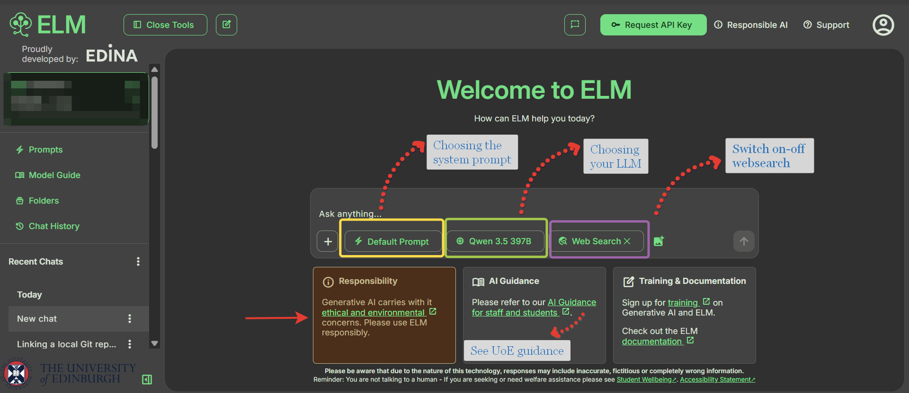
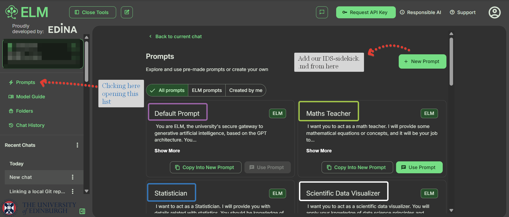
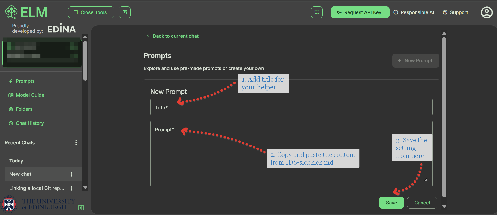

```{r setup, include=FALSE}
knitr::opts_chunk$set(eval = FALSE)
```

```{r unsplash, fig.margin = TRUE, echo = FALSE, eval = TRUE, fig.cap = "LLM scene from Unsplash"}
knitr::include_graphics("img/llm-unsplash.avif")
```


# First natural message
Overall, the less use of GenAI is the best for your learning regarding the fact that IDS is the introductory level course on data science with R programming. The main goal for you is to develop the necessary skills first, for that reason, you need to be really cautious while using GenAI in that course. 

The class time in the course (lectures and workshops), as well as the sequence of course content and the related assessments, are organised to give you as much hands-on practice as possible, with the supported readings if you like. 

If you want to learn R programming via IDS at a certain level, it is only possible to do your own writing, running, reviewing, and debugging code. In the process of all these acts, you realize that you will hone other important skills like problem solving, critical thinking, communication, collaboration, and resilience... all crucial skills in your professional life. 

> Delegeting all above to AI tools, many listed benefits above can be lost because of cognitive offloading.

🚘🚘 As a general rule, unless otherwise is stated, it is beneficial to avoid use of AI tools, to reduce the potential harm on your learning. For sure, there could be certain exceptions if we use such tools more strategically, for the purpose of supporting your learning journey.

## Our exception: Using GenAI in the IDS

There is one exception to the above main message; there can be productive ways to use GenAI specifically to help and accelerate your learning (rather than you just bypassed data science tasks with AI tools).

Just to start with a reminder, let me highlight the earlier shared main policy details first 

**In-class test:**

- AI tools (e.g., ELM, chatGPT) should not be used for this assessment. Using AI without authorisation might constitute academic misconduct.
- Please ensure that you do not input direct exercise questions into the AI prompts.

**homework and quizzes:**

- AI tools (e.g., ELM, chatGPT) may be used for specific components of this assessment for learning purposes and the development of AI literacy. 
- Using AI without authorisation might constitute academic misconduct, unless it is suggested otherwise.
- Please make sure that you do not input direct exercise questions into the AI prompts, unless it is suggested otherwise.

**Final Project:**

- AI tools (e.g., chatGPT, ELM) should not be used to generate content for this assessment. However, you are allowed to use these tools to identify ideas, help organize your thoughts, and plan your assessment.
- You may also use it to improve the clarity of your writing, but you should not use it in the final wording of your work. In particular, you should not copy-paste entire sentences produced by genAI.
- For example, you may use genAI tools for learning purposes, to enhance your understanding and develop your skills independently, similar to how you would use search engines to research information, or as a virtual tutor.
- Be aware that relying on GenAI tools for coding or simply copy-pasting their output will limit your ability to really learn and develop your coding skills. - If you used a GenAI tool to get help with a coding task, make sure you type out the solution (after having fully understood what it does) instead of copy-pasting the output.
- If you use AI software, you must acknowledge its use in your submission. We will share specific GenAI disclosure place on the report template.

## General Principles

🚘🚘 The goal is simple: **use AI to help you learn, not to replace the learning**.

Another main rule to remember is that, try to solve first without getting any help. As I said always, certain level of struggle is our friend, not our enemy. Overall, these are always worth to remember while using such tools

- Make sure that AI is your partner, not replacing you or hiding your voice 
- Do not automate what you need to do, or bypass via AI, augmentation is better than automation.
- It is always worth remembering "Education is fundamentally human and relational"
- "Writing is Thinking" as a process, useful for learning new topics such as coding, problem solving or others
- The concept of productive failure is real, while learning in mathematics - we should avoid personal deskilling because of AI use.

> "If your goal is learning, then efficiency and ease should take a back seat". (Brooke Macnamara)

## How to use it then ?

If you would like to use AI, as learning partner, it is better to guide it properly via specific behind-the-scene prompts. Besides, for the equitability reasons, we are suggesting to use University of Edinburgh platform to explore different models via one address easily (free and protected way).

For that purpose, you can use with ELM (https://elm.edina.ac.uk/), which allows you work with many state of-the-art models, while ensuring the privacy of your data. 

To facilitate further help and exploration with AI tools, we have a specific set of instructions to feed to the system first. This is called, "IDS-sidekick.md" (referring to my earlier project idea) and designed as .md file so that you can easily use to add into ELM system. 

> Sidekick means - a person who works with someone who is more important than they are- according to the Cambridge dictionary, just as a user-friendly wording that we can imagine, treat it as "very helpful tutor" to guide for you to learn. 

The goal of "IDS-sidekick.md" is to make sure that the GenAI does not hinder your
learning; instead, similar to a human tutor, it will try to help you to work through problems by yourself to develop your own IDS skills.

```
For sure, this created system prompt, one specific set of instructions designed for IDS, after various iterations. Still, its performance subject to the user query and the selected model performance overall.
```

To start with, to instruct any GenAI within the ELM platform, this is the step by step approach to follow:

- Log into ELM (https://elm.edina.ac.uk/discovery) with your University login.

```{r ,eval=TRUE, echo=FALSE, fig.height=20}

```


-  Once logged in, at the top left of the screen, click on "Tools", then "Prompts (https://elm.edina.ac.uk/elm/prompts)".

- Click on "+ New Prompt" on the right. Give it a name (e.g. "IDS helper"), copy and paste the contents of "IDS-sidekick.md" into the specified box, and save it for further use.

```{r, eval=TRUE ,echo=FALSE}

```

- Once it's saved, when you start a new chat, you can select the tutor prompt using the button just below the text input field.

```{r, eval=TRUE, echo=FALSE}

```

You can use that helper for certain exercises and instances, as mentioned before, try to solve first is the thing you need to remember always. Besides, this suggestion is not a general one, so you do not have to use it regularly for your learning, if you do not want to. In general, this helper is designed with Socratic approach to support your learning. 

For some exercises in specific labs or quiz exercises, you can do some interaction with GenAI tools via this approach to get systematic help that serves for supporting your learning, instead of hindering!

```
Using this tutor prompt on ELM is the only authorised use of AI in the course (both for your own learning and for completing assignments).
```

## Recommended use of AI

😐😐 Unless otherwise stated, the guidance here is not telling you that using AI is always acceptable! 

Also, **the behavior of copy and paste a question or an exercise** directly into the chat is **not supported for educational purposes**. 

```
Instead, you should state the problem in your own words first after your attempts; then if you need to interact with AI tools in ELM for specific tasks or get some help you should be able to explain what exactly you need help with, as part of your learning.
```

```
Keep in mind that the **AI tutor will not always be
correct**, and that it can sometimes still be **too helpful** by trying to do some of the work for you, that **we should avoid in general**.
```

These are some general recommendations for you while using this systematic use;

- Ask questions to clarify or explain programming concepts in R.
- Generate some practice exercises based on already attempted ones or similar examples from other reading materials to check your understanding.
- Ask for help when you're stuck with an coding exercise or a R coding issue.
- Get advice about which specific R functions could be useful to perform a particular task (i.e. such as choosing certain number of rows via tidyverse package only.).
- If you really need it, get some help on clarification or simplification of a documentation page to better understand how to use a specific R function or related package; ask for more code examples to support your learning. 

```
Everything you submit for any assessment must be written and R-coded by you, and must be the product of your own reasoning for individual assessments or overall team work reasoning for the final project!
```

## GenAI Playground Items

😐😐 As I mentioned in the first week, there could be some specific exercises that you can use AI as helper to explore new concepts or get some systematic help. 

For these specific exercises, I will intentionally use the tag **GenAI playground item** and also refer to the above style of AI usage. 

For these type of examples, I would like to share specific learning framework that I proposed this semester (adapted from AI terminology landscape)

**Think-Plan-Attempt-Share (TPAS)**

| Stage | What you do | Time |
|----|:------------|:-----:| 
| 1. **Think** | Observe the given code example and think individually what it does, try to examine the steps of analysis | 5 min |
| 2. **Plan** | Carry out the plan in R, get some help from "IDS-helper" **if needed** | 10 min |
| 3. **Attempt** | Write your R code based on planning and check your output against your plan and revise **if needed** | 15 min |
| 4. **Share** | Compare your approaches with others and do human collaboration for further improvement/corrections | 10 min |

- For certain tasks, you will see this type of exploration with the tag **GenAI playground item** to introduce and apply this framework whenever suggested 
- You can specifically get some help in the stages of Plan and Attempt, whereas you should avoid AI tool usage in Think stage. Your helper prompt above, "IDS-sidekick.md" can be reused when you defined as it is suggested above in the ELM environment.
- In the Share stage, you can discuss within your team, and also ask to IDS-helper in ELM for additional explanation and clarification, or other related brainstorming. 

```
For the attempt part, you can think of the pair programming again, but make sure that during the workshop session, you rotate the roles enough so that both driver and navigator roles you take on
```

### GenAI Acknowledgment

In some cases, you may required to share specific GenAI disclosure or acknowledgement. Below are some simple way of writing, unless you are explicitly asked to write something different: 

If you used ELM via IDS-sidekick prompt, provide a statement like this, whenever it is required

> I used ELM with IDS-sidekick prompt to discuss wrangling and explain Base R code, and to clarify syntax. I did not copy any code directly, and verified any advice through my own R coding and interpretation.

If you used any other AI for this lab rather than ELM, provide a statement like (make sure to specify which GenAI tool you used):  

> I used ChatGPT/Copilot/Claude to discuss wrangling and explain Base R code, and to clarify syntax. I did not copy any code directly, and verified any advice through my own R coding and interpretation.

