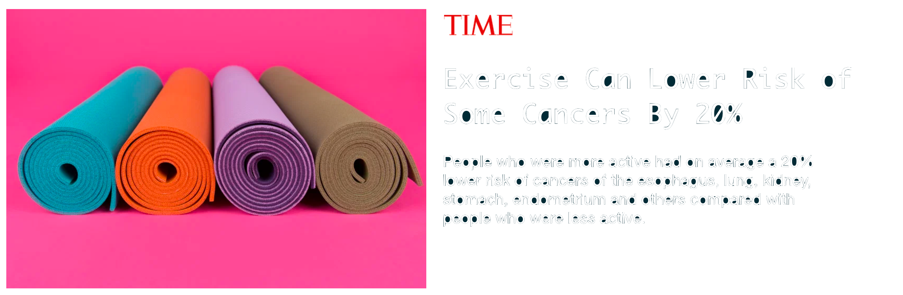
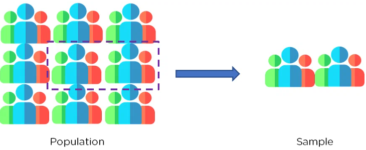
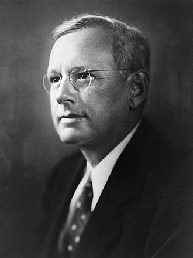
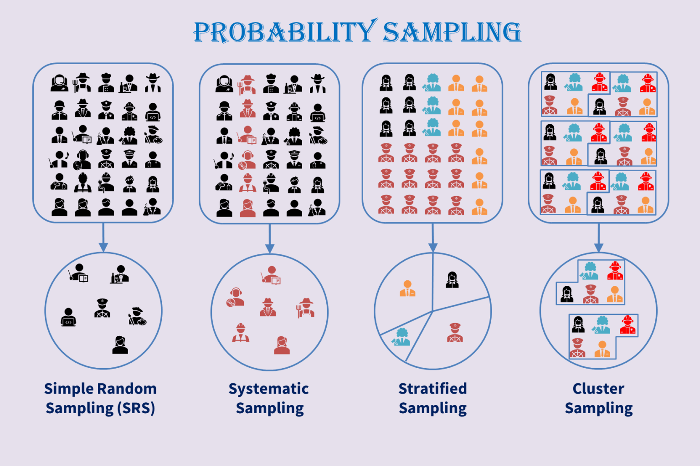
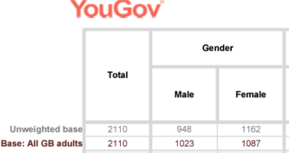
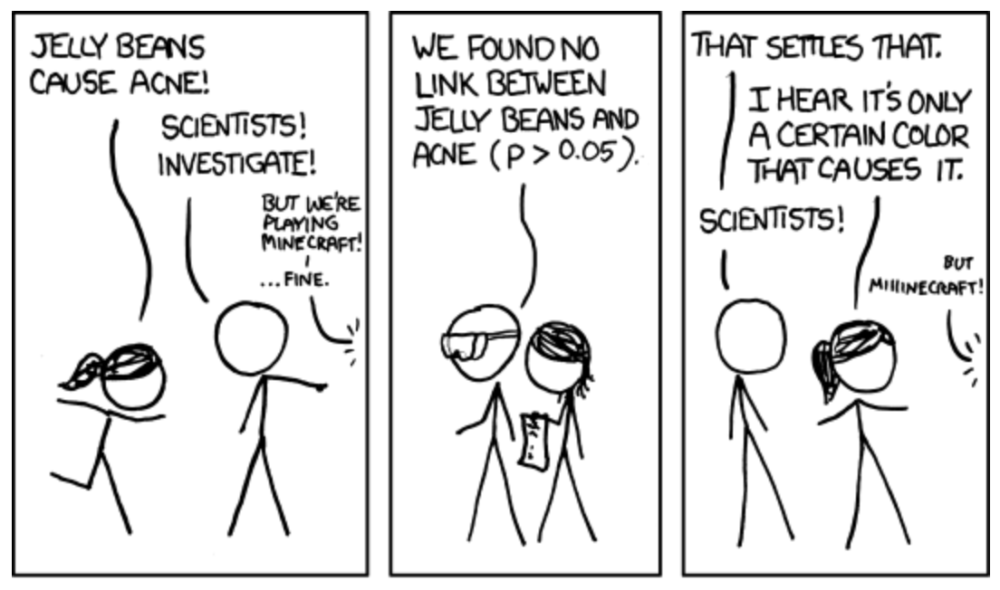
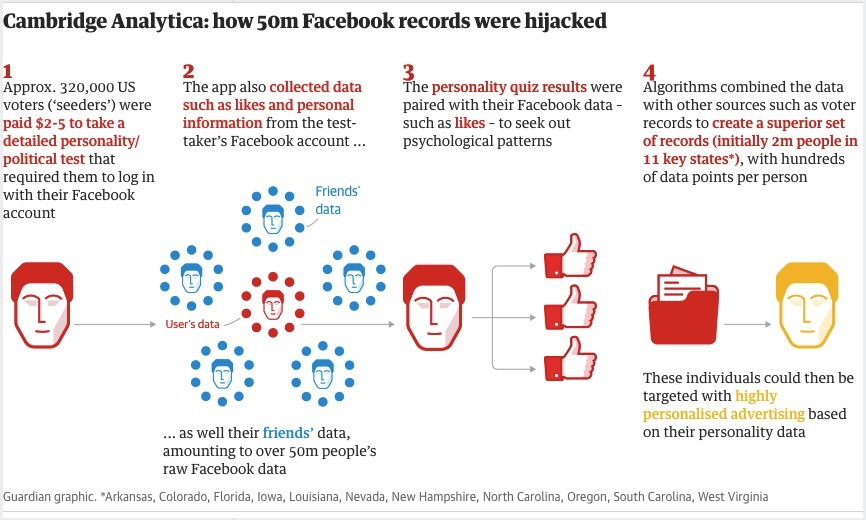

```{r packages, echo=FALSE, message=FALSE, warning=FALSE}
library(tidyverse)
library(magick)
library(xaringanExtra)
library(Tmisc)
library(dsbox)
xaringanExtra::use_panelset()

knitr::opts_chunk$set(echo = FALSE, message = FALSE, warning = FALSE,
                      fig.retina = 2, dpi = 150)
theme_set(theme_minimal(base_size = 18))
```

class: middle

# Case Study: Sunday Art Gallery Attendance

---

## Sunday Art Gallery Attendance

The Guildhall Art Gallery in London investigated Sunday attendance figures for its Loan Collection exhibition during the Spring/Summer season for two years.

* Total Sunday Attendance:
  * Year 1 - 17,530 people
  * Year 2 - 19,732 people

.question[In which year was the gallery more popular?]

--

* Average Sunday Attendance Rate:
  * Year 1 - 2,921 people per day
  * Year 2 - 1,517 people per day

.question[In which year was the gallery more popular?]

---

## 'Sunday Opening in the City'

* Case study from _The Times (London)_, July 25 - August 1, 1895.
* Series of 5 letters 'To The Editor of the Times'
* Same data used to argue **for** & **against** Sunday Opening of museums, galleries and libraries.

.question[

"I think Lord Beaconsfield said that there were three degrees of veracity - viz, lies, d---d lies, and statistics."

_W. P. Treloar, The Times (London), July 26, 1895_
]

**Message**: Understand the data and how it is collected. The gallery was open for 6 Sundays in 1894, and for 13 Sundays in 1895 to address overcrowding in the previous year.


---

## Case Study: Exercise and Cancer


```{r out.width = "100%"}

```

.footnote[
.midi[
Alice Park. [Exercise Can Lower Risk of Some Cancers By 20%](https://time.com/4330041/reduce-cancer-risk-exercise/). Time Magazine. 16 May 2016.
]
]

---

## Original study

Moore, Steven C., et al. **["Association of leisure-time physical activity with risk of 26 types of cancer in 1.44 million adults."](https://jamanetwork.com/journals/jamainternalmedicine/fullarticle/2521826)** JAMA internal medicine 176.6 (2016): 816-825.

Methods:
  - A substantive meta-analysis, pooling together research from multiple US & EU studies.
  - "The median activity level was 8 MET-h/wk. This is equivalent to 150 minutes of moderate intensity activity (e.g. walking) per week, and comparable to the median activity level for the US population."
  - The hazard ratio for a range of cancers was evaluated by comparing the higher (top 20%) vs the lower (bottom 20%) groups of physical activity.

Findings:
  - "High vs low levels of leisure-time physical activity were associated with lower risks of **13 of 26** cancers." (no association in 13 other cancers.)


---

## Original study

Moore, Steven C., et al. **["Association of leisure-time physical activity with risk of 26 types of cancer in 1.44 million adults."](https://jamanetwork.com/journals/jamainternalmedicine/fullarticle/2521826)** JAMA internal medicine 176.6 (2016): 816-825.


Acknowledgement of limitations:
  - "The main limitation of our study is that ... we cannot fully exclude the possibility that residual **confounding** by diet, smoking, or other factors may affect our results."
  - "An additional limitation is that we used **self-reported** physical activity, which entails some error in recall."


**Message**: Clarity in communication is important to minimise misunderstanding. Not only about the methods and findings, but crucially about the _assumptions_ and _limitations_.


---

## Absolute vs Relative Risk

```{r absVrel, fig.align='center', fig.width = 12, fig.height=6}
x1 <- 0.5
x2 <- 0.05
data.frame(
    x = c(x1,x1*(1-0.2), x2, x2*(1-0.2))*100,
    grp = factor(c("before", "after", "before","after"), levels = c("before", "after")),
    eg = c("Example 1", "Example 1", "Example 2", "Example 2")
    ) %>%
ggplot(mapping = aes(x = grp, y = x, fill = grp)) +
  geom_col() +
  geom_text(aes(label = paste0(round(x),"%")), vjust = -0.5) +
  facet_wrap(~eg) +
  coord_cartesian(ylim = c(0,max(x1,x2))*100) +
  labs(y = 'Absolute Risk',
       x = '',
       title = 'Illustration of a relative risk reduction of 20%.')+
  theme_grey(base_size = 11) +
  theme(legend.position="none")

```

**Message**: Take care about the _meaning_ of statistics. Are you giving the full picture?


---

class: middle
# Misleading visualisation

---

## Spot the problem

```{r vis-data}
votes <- tibble(option = c("Option A", "Option B"), pct = c(51, 49))

p_votes <- ggplot(votes, aes(x = option, y = pct, fill = option)) +
  geom_col(width = 0.6) +
  geom_text(aes(label = paste0(pct, "%")), vjust = -0.4, size = 6) +
  scale_fill_manual(values = c("#1b9e77", "#7570b3")) +
  labs(x = NULL, y = "Support (%)") +
  theme(legend.position = "none")

sales <- tibble(
  month = 1:120,
  index = 50 + 0.5 * month + 8 * sin(2 * pi * month / 24)
)
window <- filter(sales, month %in% 103:113)
```

.pull-left[
```{r vis-bad-1, fig.height = 4.5, fig.width = 6}
p_votes +
  coord_cartesian(ylim = c(48, 52)) +
  labs(title = '"A landslide for Option A!"')
```
]

.pull-right[
```{r vis-bad-2, fig.height = 4.5, fig.width = 6}
ggplot(window, aes(month, index)) +
  geom_line(linewidth = 1.5, colour = "#d95f02") +
  geom_point(size = 2.5, colour = "#d95f02") +
  labs(x = "Month", y = "Sales index", title = '"Sales are collapsing!"')
```
]

.question[
What is misleading about each chart?
]

---

## What was wrong?

.pull-left[
```{r vis-good-1, fig.height = 4.5, fig.width = 6}
p_votes +
  coord_cartesian(ylim = c(0, 100)) +
  labs(title = "Axis from 0% to 100%")
```

**Truncated axis.** With bars, length encodes the value, so the axis should start at zero. ]

.pull-right[
```{r vis-good-2, fig.height = 4.5, fig.width = 6}
ggplot(sales, aes(month, index)) +
  annotate("rect", xmin = 103, xmax = 113, ymin = -Inf, ymax = Inf,
           fill = "#d95f02", alpha = 0.2) +
  geom_line(linewidth = 1.2) +
  labs(x = "Month", y = "Sales index", title = "The full 10 years")
```

**Cherry-picked time window.** Choosing where the chart starts and ends lets you tell almost any story. Ask: _why does it start and end there?_
]

---

## What is data misrepresentation?

- _Data_ is messy, but it contains _Information_.
- A _Data Scientist_ can access this information through a variety of tools.
- The use of different tools can obtain different insights into the data.
- Consequently, a data scientist must be skilled to _understand_ what is the right tool to use.
- In other words, data scientists must be **data literate**.

.question[
**Data Literacy** - the ability to _explore_, _understand_ and _communicate_ data in a meaningful way.
]


.question[
**Misrepresentation** of data arises from the application of poor data literacy skills, typically resulting in false data interpretations.
]


---

## Some causes of misrepresentation


* A lack of understanding of the data:
  - What is the context of the data?
  - For what purpose was the data collected?
  - What do the variables mean?
* Insufficient or unrepresentative data:
  - Are there enough observations to conclude something meaningful?
  - Has the data been collected in a way that represents the studied population?
* Problems with applying analysis:
  - Inappropriate use of data science tools
  - Blind application of methods without considering subtleties
  - Cherry picking (of data, of time windows, of results)
* Is the interpretation of findings fair and balanced:
  - Clarity on assumptions and limitations
  - Is there an over emphasis of the 'interesting' result?
  - Incorrect implication of causal relationships


<!-- However, since researchers often disagree about the proper use of statistical techniques and other means of representing data, the line between misrepresentation of data and ‘disagreement about research methods’ is often blurry. -->

---

## Themes & principles in ethical data science

* **Seek to enhance the values of data science for society**
  - Data science can be beneficial and detrimental.
  - Seek to understand the potential impact.
  - Strive to seek fairness
* **Avoid harm**
  - Must adhere to laws around data protection and discrimination.
* **Apply and maintain professional competence**
  - Minimise uncertainty and risk by complying with professional best practices.
* **Seek to preserve or increase trustworthiness**
  - Work closely with the public and stakeholders to build trust and understanding.
  - Be open and truthful about the benefits and limitations of data and algorithms.
* **Maintain accountability and oversight**
  - Transparency and reproducibility of research.
  - Oversight considerations in AI decision making.

Source: [Institute and Faculty of Actuaries](https://actuaries.org.uk/standards/data-science-ethics/)

---

class: middle
# Statistical principles

---

## Data Representativeness

.pull-left[

.question[
**Population**: The entire set of items (eg. people) that you plan to investigate as part of a statistical study.

**Sample**: A subset of items from the population from which measurements are collected.
]

]

.pull-right[
```{r out.width = "100%"}

```

]

* The objective of data science is to summarise the data from the sample to _infer_ properties about the population.

* Unrepresentative **biased** data can result in inappropriate or **biased** findings.


---

## Historical Case Study: Landon vs Roosevelt

.pull-left[
* 1936 US presidential election:
  - Rep: Alf Landon
  - Dem: Franklin Roosevelt
* Opinion poll conducted by Literary Digest magazine:
  - Polled 10 million individuals
  - Received 2.27 million responses
  - Projected winner: Alf Landon
* Franklin Roosevelt won the election!
]

.pull-right[
```{r out.width = "40%"}


```

]

.midi[
- Cause for the error - sampling bias!
  - Sampled from magazine subscribers, registered vehicle owners and telephone users.
  - Historical context: election happened during the 'Great Depression' (1929-1939)
  - Consequently, sample disproportionately polled higher-income voters.
- **It still happens:** at the 2015 UK general election, polls pointed to a hung parliament; the Conservatives won a majority. The British Polling Council's inquiry concluded the main cause was **unrepresentative samples**.
]

???

Reference for the 2015 inquiry: Sturgis et al. (2016), Report of the Inquiry into the 2015 British general election opinion polls.

---

## Sampling Methods

```{r out.width = "70%", fig.align='center'}

```

.small[
**Source**: Trivedi (2020) [Probability Sampling](https://conceptshacked.com/probability-sampling/)
]

---

## Bias correction


.pull-left[
* Suppose your sample is biased
* _And_ you can quantify the scale of the bias
* Then you should attempt to correct your estimates.

**Example**

* Are you in favour of statement "X"?
  - Male: 20% in favour
  - Female: 75% in favour
]

.pull-right[

```{r out.width = "100%", fig.align='center'}

```

]


* Unweighted (biased) overall opinion: $~~~20\%~\frac{948}{2110} + 75\%~\frac{1162}{2110} = 50.3\%$ in favour
* Weighted (bias corrected) overall opinion: $~~~20\%~\frac{1023}{2110} + 75\%~\frac{1087}{2110} = 48.3\%$ in favour


---

class: middle
# Reproducibility and research integrity

---

## Look hard enough and you'll find something

.center[
<a href="https://xkcd.com/882/"></a>
]

.footnote[[xkcd #882: "Significant"](https://xkcd.com/882/), Randall Munroe, CC BY-NC 2.5]

---

## Case Study: Surgisphere (2020)

* In May 2020, _The Lancet_ and _The New England Journal of Medicine_ published two high-profile COVID-19 studies, both based on a database of hospital records supplied by the company Surgisphere.
* Researchers and journalists spotted implausible numbers (e.g. more COVID deaths in Australian hospitals than had been officially recorded in the whole country), and hospitals listed in the database said they had never heard of Surgisphere.
* Surgisphere refused to give independent auditors access to the data, citing confidentiality agreements. Three of the four co-authors, who had never seen the raw data themselves, asked for the papers to be retracted. **Both were retracted in June 2020.**

**Message**: If no one else can check your data and code, no one should trust your results. This is why we use **reproducible** workflows (R Markdown / Quarto, version control, shared data and code).
---

class: middle
# Privacy and anonymisation

---

## "Anonymised" data often isn't

* **Linking datasets**: in 1997, Latanya Sweeney re-identified the medical records of the Governor of Massachusetts from "anonymised" health insurance data on state employees, by linking them with a public voter register (bought for $20).
  - She later estimated that **ZIP code + date of birth + sex** is enough to uniquely identify about 87% of the US population.
* **The Netflix Prize (2006-2009)**: Netflix released "anonymised" movie ratings from about 500,000 subscribers for a competition.
  - Narayanan & Shmatikov (2008) showed that knowing just a few of someone's ratings and roughly when they were made is enough to pick out their record.
  - Matching against public IMDb reviews, they re-identified users and revealed **every** film those users had rated on Netflix, not just the public ones.
  - A planned second competition was cancelled after a privacy lawsuit.

.question[
Removing names is **not** anonymisation. Any combination of attributes that is rare can act as a fingerprint.
]

---

## Protecting privacy in practice

* **Data minimisation**: only collect and keep what you need.
* **Aggregation**: publish counts or summaries; suppress small cells (e.g. groups with fewer than 10 people).
* **Pseudonymisation**: replace identifiers with codes, but remember this is still personal data under UK GDPR.
* **Differential privacy**: add carefully calibrated random noise so that the output is almost the same whether or not any one person is in the data.
  - Used by the US Census Bureau for the 2020 Census.
  - Introduces a **trade-off**: more privacy means less accuracy, particularly for small areas and small groups.

.question[
Which is worse: publishing statistics that might reveal individuals, or publishing statistics that are deliberately less accurate?
]

---

class: middle
# When data science meets the law

---

## Case Study: Cambridge Analytica

.pull-left[
* 2014: a personality-quiz app on Facebook collected data from ~270,000 users _and their friends_, eventually about 87 million profiles.
* The data was passed to Cambridge Analytica and used to build psychological profiles for political advertising.
* 2018: revealed by _The Guardian_, _The Observer_ and _The New York Times_.
* Facebook was fined £500,000 by the UK Information Commissioner (the maximum under pre-GDPR law).

 [The Guardian - Cambridge Analytica whistleblower](https://www.youtube.com/watch?v=FXdYSQ6nu-M)
]

.pull-right[
```{r out.width = "100%", fig.align='center'}

```
]

---

## UK data protection law

* **UK GDPR** + **Data Protection Act 2018**, amended by the **Data (Use and Access) Act 2025**.
* **Personal data** - information that relates to an identified or identifiable individual.
    - name, identification number, location, biometric data, digital identifiers, opinions & beliefs, etc.
* You need a **lawful basis** to process personal data. Consent is only one of them; where it is used, it must be informed, freely given, and can be withdrawn.
* Personal data must be **stored securely**:
  - Limiting access 
  - Controls against malicious attacks
  - Anonymising or de-identifying data to limit harm in case of breaches
  - Case Study: [Police Service of Northern Ireland data breach](https://www.bbc.co.uk/news/uk-northern-ireland-66448442) (2023)

See the University's website for further information and training on [Data Protection](https://www.ed.ac.uk/data-protection).

???

The Data (Use and Access) Act 2025 received Royal Assent on 19 June 2025 and is being commenced in stages.
It relaxes some of the restrictions on automated decision-making (except where special category data is involved) but makes the safeguards above mandatory.
It also adds "recognised legitimate interests" as a lawful basis. Check which provisions are in force before the lecture.

---

## Creative Commons Licenses (version 4.0)

* Allows the creator to retain copyright whilst allowing others to copy and distribute their work.
* This applies to data and the publication of results.
* Different types of licenses control the use and distribution of copyrighted content.
* License conditions include:
  - (BY) Credit must be given to the creator.
  - (SA) Adaptations must be shared under the same licensing terms.
  - (NC) Derived products must be for non-commercial purposes.
  - (ND) Cannot adapt or produce any derivatives of the work.

Source: [Creative Commons](https://creativecommons.org/share-your-work/cclicenses/)

