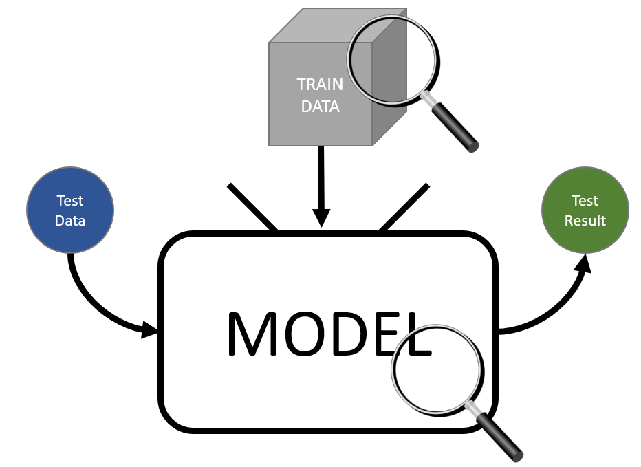
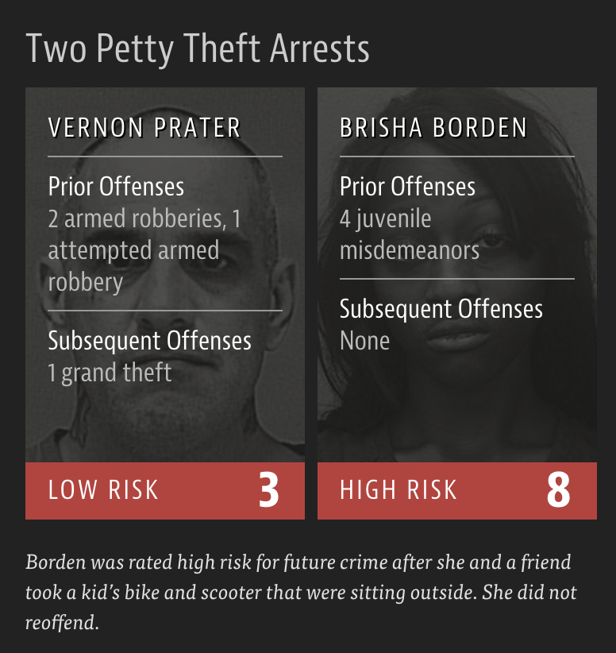
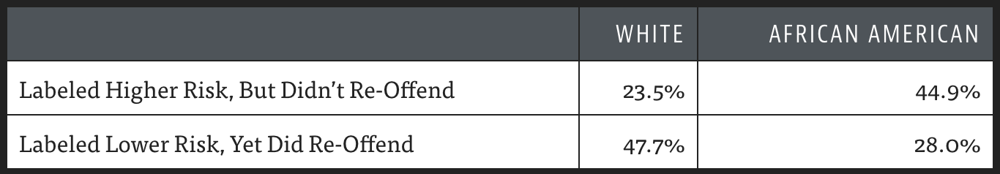
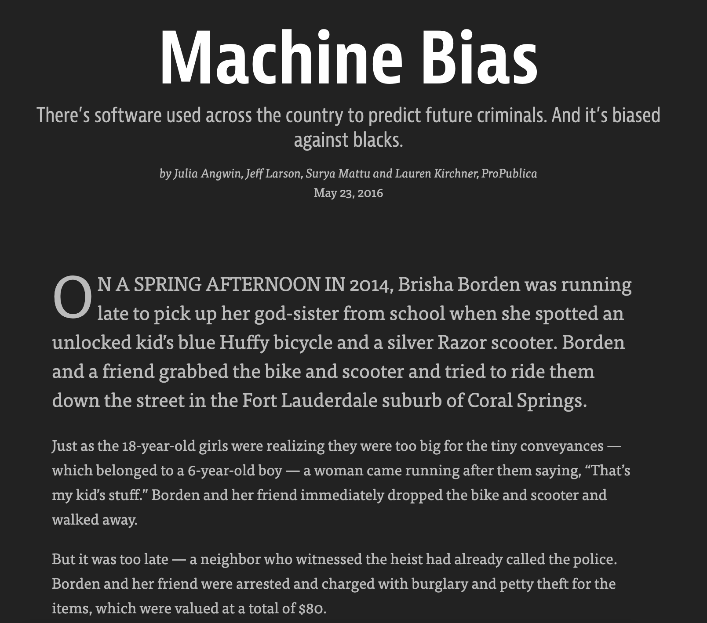
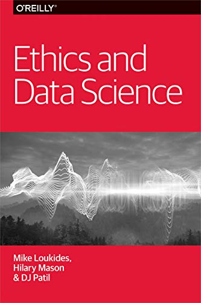
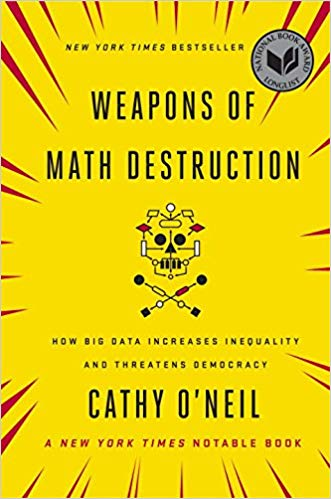
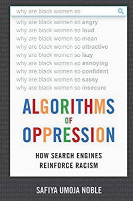
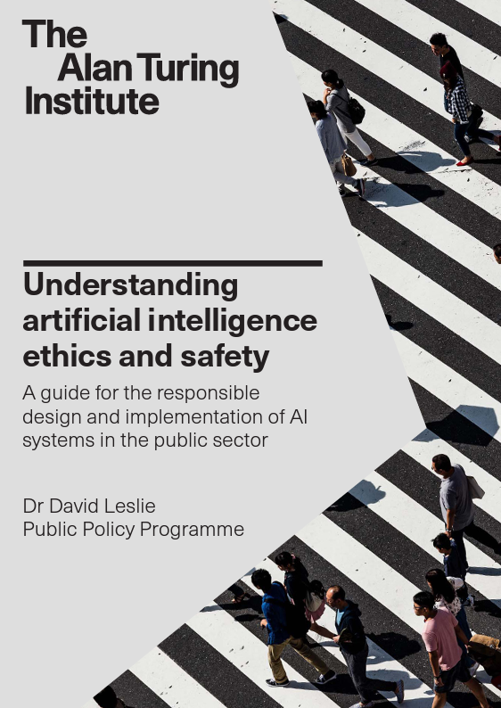

```{r packages, echo=FALSE, message=FALSE, warning=FALSE}
library(tidyverse)
library(magick)
library(xaringanExtra)
library(Tmisc)
library(dsbox)
xaringanExtra::use_panelset()

knitr::opts_chunk$set(echo = FALSE, message = FALSE, warning = FALSE,
                      fig.retina = 2, dpi = 150)
```


class: middle
# Case Study: Amazon's hiring algorithm

---

## Amazon's experimental hiring algorithm

- Used AI to give job candidates scores ranging from one to five stars -- much like shoppers rate products on Amazon
- Trained on CVs submitted to Amazon over the previous 10 years, most of which came from men
- Amazon's system was not rating candidates for software developer jobs and other technical posts in a gender-neutral way; it taught itself that male candidates were preferable

> Gender bias was not the only issue. Problems with the data that underpinned the models’ judgments meant that unqualified candidates were often recommended for all manner of jobs, the people said.

.footnote[
Jeffrey Dastin. [Amazon scraps secret AI recruiting tool that showed bias against women](https://reut.rs/2Od9fPr).
Reuters. 10 Oct 2018.
]

---

## Removing gender doesn't remove bias

* The model was never given the candidate's gender.
* But it learned to penalise CVs that contained the word **"women's"** (e.g. "captain of the women's chess club") and to downgrade graduates of two all-women's colleges.
* Amazon edited the model to ignore those terms, but could not guarantee it wouldn't find other **proxies**, and abandoned the project.

.question[
**Proxy variable**: a variable that is not itself a protected characteristic but is strongly associated with one (e.g. postcode and ethnicity, first name and gender, height and sex).
]

**Message**: "We didn't include race/gender in the model" is not evidence that the model is fair. You have to **measure** its behaviour across groups.

---

## Where is the bias?

```{r out.width="60%", fig.align='center'}

```

---

## Sources of bias in the modelling process

* **Historical bias**: the world the data reflects is already unequal (e.g. who was hired in the past).
* **Representation bias**: some groups are under-represented in the training data.
* **Measurement bias**: the variable you can measure is a poor proxy for the thing you care about (e.g. _arrests_ instead of _crimes_, _healthcare cost_ instead of _health need_).
* **Aggregation bias**: one model for everyone, when the relationship differs between groups.
* **Evaluation bias**: the test data or benchmark doesn't represent the people the model will be used on.
* **Deployment bias**: the model is used for a different purpose or population than it was built for.

.footnote[
Adapted from Suresh & Guttag (2021). [A Framework for Understanding Sources of Harm throughout the Machine Learning Life Cycle](https://arxiv.org/abs/1901.10002).
]

---

## Models learn the quirks of their training data

.pull-left[

```{r}
df <- tibble(x = c(0.491, 0.833, 0.758, 0.902, 0.278, 0.446, 0.272, 0.33, 0.864, 0.11),
             y = c(0.466, 0.817, 0.696, 0.992, 0.179, 0.531, 0.353, 0.283, 0.948, 0.209))
df_new <- tibble(x = seq(0,1,by=0.01))
df_point <- tibble(x = c(0.16,0.63))
M1 <- lm(y ~ x, data = df)
M2 <- lm(y ~ poly(x, 7), data = df)
df_new$y_M1 <- predict(M1,newdata = df_new)
df_new$y_M2 <- predict(M2,newdata = df_new)
df_point$y_M1 <- predict(M1,newdata = df_point)
df_point$y_M2 <- predict(M2,newdata = df_point)

ggplot(data = df, mapping = aes(x=x, y=y)) +
  geom_point(cex = 2) +
  theme_bw() +
  labs(x = "x", y = "y") +
  coord_cartesian(xlim=c(0,1), ylim = c(0, 1))
```


]
.pull-right[

Fit accuracy: (residual sum of squares)
$\sum_{i=1}^n (y_i - \hat{y}_i)^2$
* Model 1: `r round(sum((predict(M1)-df$y)^2), 2)`
* Model 2: `r round(sum((predict(M2)-df$y)^2), 2)`

.question[
Q1: Which model gives a better fit to the data?
]


]


---

## Specific vs Generalisable

.pull-left[

```{r fig.height = 5}
ggplot(data = df, mapping = aes(x=x, y=y)) +
  geom_point(cex = 2) +
  theme_bw() +
  labs(x = "x", y = "y", title = "Model 1") +
  coord_cartesian(xlim=c(0,1), ylim = c(0, 1)) +
  geom_line(data = df_new, mapping = aes(x=x,y=y_M1), linewidth = 1.2) +
  geom_point(data = df_point, mapping = aes(x=x,y=y_M1), col=c("blue","red"), pch="X",cex=10)
```

]
.pull-right[
```{r fig.height = 5}
ggplot(data = df, mapping = aes(x=x, y=y)) +
  geom_point(cex = 2) +
  theme_bw() +
  labs(x = "x", y = "y", title = "Model 2") +
  coord_cartesian(xlim=c(0,1), ylim = c(0, 1)) +
  geom_line(data = df_new, mapping = aes(x=x,y=y_M2), linewidth = 1.2)+
  geom_point(data = df_point, mapping = aes(x=x,y=y_M2), col=c("blue","red"), pch="X",cex=10)
```
]

.question[
Q2: For which model are you more likely to trust the predictions at $x=0.16$ and $x=0.63$
]


---


class: middle

# Algorithmic bias and race

---

## Criminal Sentencing

.center[
"There’s software used across the country to predict future criminals.
And it’s biased against blacks".
]

```{r out.width="60%", fig.align='center'}
knitr::include_graphics("img/propublica-criminal-sentencing.png")
```

.footnote[
.midi[
Julia Angwin, Jeff Larson, Surya Mattu, and Lauren Kirchner. [Machine Bias](https://www.propublica.org/article/machine-bias-risk-assessments-in-criminal-sentencing). 23 May 2016. ProPublica.
]
]

---


## A tale of two convicts

.pull-left[

]

.pull-right[

]

---

class: middle

>“Although these measures were crafted with the best of intentions, I am concerned that they inadvertently undermine our efforts to ensure individualized and equal justice,” he said, adding, “they may exacerbate unwarranted and unjust disparities that are already far too common in our criminal justice system and in our society.”
>  
>Then U.S. Attorney General Eric Holder (2014)

---

## ProPublica analysis

### **Data:**

Risk scores assigned to more than 7,000 people arrested in Broward County, Florida, in 2013 and 2014 + whether they were charged with new crimes over the next two years

---

## ProPublica analysis

### **Results:**

- 20% of those predicted to commit violent crimes actually did
- Algorithm had higher accuracy (61%) when full range of crimes taken into account (e.g. misdemeanors)
```{r out.width = "85%"}

```
- Algorithm was more likely to falsely flag African American defendants as future criminals, at almost twice the rate as White defendants
- White defendants were mislabeled as low risk more often than African American defendants

---

## The company's response

Northpointe (the company behind COMPAS) disputed ProPublica's conclusion:

* Their analysis showed the scores were **equally predictive** in both groups: among defendants labelled high risk, Black and White defendants went on to reoffend at similar rates.
* In other words, a "high risk" label (or a given score) "meant the same thing" whatever your race. This property is often called **calibration** or **predictive parity**.

.question[
ProPublica: the algorithm is unfair, because the **error rates** differ between groups.
Northpointe: the algorithm is fair, because the **scores are calibrated** in both groups.

Can both be right?
]

--

.midi[
**Yes.** And when the groups have different base rates (different proportions who reoffend), it is mathematically impossible to satisfy both definitions at once (Kleinberg et al., 2016; Chouldechova, 2017).
]

---

## Defining fairness: the setup

A classification model predicts an outcome from some information about a person.

* $X$: the information used to make the prediction (e.g. criminal history, age)
* $A$: a **sensitive attribute** we don't want to discriminate on (e.g. ethnicity, gender)
* $Y$: the true outcome (e.g. did the person reoffend: 1 = yes, 0 = no)
* $R$: the model's prediction (e.g. 1 = flagged as high risk)

.question[
Each fairness criterion asks: **does knowing someone's group $A$ change something it shouldn't?**
]

.footnote[
Barocas, Hardt & Narayanan, [_Fairness and Machine Learning_](https://fairmlbook.org/) (free online); [Wikipedia: Fairness (machine learning)](https://en.wikipedia.org/wiki/Fairness_%28machine_learning%29).
]

---

## Three group fairness criteria

**Independence** (demographic parity): $\quad P(R=1 \mid A=a) = P(R=1 \mid A=b)$
* Each group is flagged as high risk at the **same rate**.

**Separation** (equalised odds): $\quad P(R=1 \mid Y=y, A=a) = P(R=1 \mid Y=y, A=b)$
* Among people who **did** (or **did not**) reoffend, each group has the same chance of being flagged.
* Equivalently: equal **false positive** and **false negative** rates. _ProPublica's criterion._

**Sufficiency** (calibration): $\quad P(Y=1 \mid R=r, A=a) = P(Y=1 \mid R=r, A=b)$
* Among people given the **same prediction**, the same share reoffend: a score means the same thing in every group. _Northpointe's criterion._

???

Read the conditions as "knowing which group you're in shouldn't change...":
- Independence: ...your chance of being flagged.
- Separation: ...your chance of being flagged, once we know what actually happened to you.
- Sufficiency: ...what your score means about what will happen to you.
Independence ignores the true outcome entirely, which is why it is often criticised: if groups genuinely differ in Y, forcing equal flag rates means making more errors in one group.

---

## You can't have them all

.midi[
* If the groups have **different base rates** (different proportions who actually reoffend), then, apart from trivial cases such as a perfect predictor:
  - **Independence** and **separation** cannot both hold.
  - **Separation** and **sufficiency** cannot both hold.
  - So it is impossible to satisfy all three at once.
* This is exactly the COMPAS dispute: the scores were roughly **calibrated** (sufficiency, Northpointe was right), _and therefore_ the error rates differed between groups (separation fails, ProPublica was right).
]

.question[
.midi[
**Which criterion should we choose?** It depends on the context and on who bears the cost of each type of mistake.
* A defendant wrongly flagged as high risk may be kept in prison: what matters to them is the **false positive rate** (separation).
* A judge wants a "high risk" label to mean the same thing for everyone (sufficiency).
* Statistics can tell you what the trade-off is, but not which side of it to pick.
]
]

.midi[
Kleinberg, Mullainathan & Raghavan (2016); Chouldechova (2017).
]

---

## Fairness definitions can conflict: a simulation

```{r fairness-sim}
set.seed(1)
n <- 10000

sim <- tibble(
  group = rep(c("Group A", "Group B"), each = n),
  high  = c(runif(n) < 0.6, runif(n) < 0.2)   # A: 60% high-risk, B: 20%
) %>%
  mutate(
    risk      = if_else(high, runif(2 * n, 0.5, 0.7), runif(2 * n, 0.1, 0.3)),
    reoffend  = rbinom(2 * n, 1, risk),       # outcome drawn from the true risk
    high_risk = risk > 0.5                    # same threshold for everyone
  )

fair_tab <- sim %>%
  group_by(group) %>%
  summarise(
    `Base rate` = mean(reoffend),
    `Flagged as high risk` = mean(high_risk),
    `Flagged who reoffend` = mean(reoffend[high_risk]),
    `Not flagged who reoffend` = mean(reoffend[!high_risk]),
    `False positive rate` = mean(high_risk[reoffend == 0]),
    `False negative rate` = mean(!high_risk[reoffend == 1])
  ) %>%
  mutate(across(where(is.numeric), function(x) scales::percent(x, accuracy = 1)))

# "Flagged" checks **independence**; false positive/negative rates check **separation**; "Flagged / Not flagged who reoffend" check **sufficiency**.
```

.midi[
* Each person has a true risk; the score **is** that true risk, so it is perfectly calibrated in both groups.
* In both groups, high-risk people have a risk score around 0.6 and low-risk people around 0.2. Group A simply has more high-risk people. The score is each person's true risk.
* Everyone is flagged using the same threshold (score > 0.5).
]

.midi[
```{r fairness-table}
knitr::kable(fair_tab, format = "html", align = "lccccc")
```
]

.midi[
* Even a perfectly calibrated score, with one threshold for everyone, gives **different false positive and false negative rates** across groups.
* Choosing which fairness definition matters is **not a purely technical decision**. It depends on context, values, and who bears the cost of each type of error.
]

???

Run this live and change the threshold or base rates to show students that the gap in error rates doesn't go away.
References: Kleinberg, Mullainathan & Raghavan (2016), "Inherent Trade-Offs in the Fair Determination of Risk Scores"; Chouldechova (2017), "Fair prediction with disparate impact", Big Data 5(2).

---

class: middle
# Recommendations - "The Algorithm"

---

## What can be inferred from your data?

Netflix's recommendations use ([source](https://help.netflix.com/en/node/100639)):
* your interaction with Netflix (viewing history, ratings, how long you watch, time of day, device)
* other members with similar tastes and preferences
* information about titles (genre, year, cast)

--

**Netflix: How did it know I was bi before I did?** [BBC News](https://www.bbc.co.uk/news/technology-66472938), 13 Aug 2023.

--

* Recommender systems can infer **sensitive characteristics** (sexuality, health, religion, politics) that you never disclosed.
* They also create **feedback loops**: you see what the model recommends, you watch it, and that becomes the next round of training data.

---

class: middle
# Generative AI: understanding its purpose

---

## Large language models (LLMs)

* ChatGPT, Claude, Gemini, Copilot, etc. are built on **large language models**.
* An LLM is trained on a very large collection of text to **predict the next word** (token), then further tuned to follow instructions and be helpful.
* Many now also use **tools**: web search, running code, reading files.
* They are very useful for drafting, explaining, summarising and writing code.

But:

* They generate _plausible_ text. Plausible is not the same as **true**.
* They can **hallucinate**: produce confident, fluent and specific content (facts, numbers, references) that is fabricated.
* They tend to **agree with you**, and can be steered by how a question is phrased.
* They reflect the **biases** in their training data (e.g. stereotypes in image generation).
* Even with search, they can misquote or misattribute sources.

---

## Case Study: fabricated legal citations

**Mata v Avianca (New York, 2023)**
* Roberto Mata sued an airline for an injury from a metal serving cart.
* His lawyers submitted a brief citing several court decisions that **did not exist**. They had been generated by ChatGPT.
* When asked, a lawyer said he thought ChatGPT was a search engine. The lawyers were fined $5,000.

--

**It's not just a US problem, and it hasn't gone away.**

* In [_Ayinde v London Borough of Haringey_ [2025] EWHC 1383 (Admin)](https://caselaw.nationalarchives.gov.uk/ewhc/admin/2025/1383), the High Court of England and Wales dealt with submissions that cited fictitious cases.
* The court warned that lawyers who cite AI-generated material without checking it risk serious professional consequences, including referral to regulators.

**Message**: You are responsible for everything you submit, whoever (or whatever) wrote the first draft.

---

## Using AI tools responsibly as a data scientist

* **Verify**: check every fact, reference and number. Run and test any code it produces; read it and make sure you understand it.
* **Protect data**: pasting personal or confidential data into a public chatbot may breach data protection law (and your employer's or the University's rules).
* **Be transparent**: follow the course and University guidance on acknowledging the use of generative AI in your work.
* **Know its limits**: an LLM is not a source. Cite the original paper, dataset or documentation.

<!-- TODO: add link to the University's / course's guidance on generative AI use in assessments. -->

---

## Wider ethical questions about generative AI

* **Training data**: much was collected from the web without the creators' consent. Several copyright lawsuits are ongoing.
* **Hidden labour**: models are refined using human feedback and content moderation, often outsourced to low-paid workers.
* **Environmental cost**: training and running large models requires large amounts of electricity and water for cooling.
* **Synthetic media**: realistic fake images, audio and video (deepfakes) used for fraud, harassment and disinformation.
* **Concentration of power**: only a few organisations can afford to build the largest models.

---

## Parting thoughts

- At some point during your data science learning journey you will learn tools that can be used unethically

- You might also be tempted to use your knowledge in a way that is ethically questionable either because of business goals or for the pursuit of further knowledge (or because your boss told you to do so)

- Many of today's harms were not caused by bad intentions, but by not asking: _Who is in the data? What is really being measured? Who is affected by the errors? Can they challenge the decision?_

.question[
How do you train yourself to make the right decisions (or reduce the likelihood of accidentally making the wrong decisions) at those points?
]

---

## Further reading

.panelset[

.panel[.panel-name[Machine Bias]


.pull-left[

```{r out.width="80%", fig.align='center'}

```
]
.pull-right[
[Machine Bias](https://www.propublica.org/article/machine-bias-risk-assessments-in-criminal-sentencing)
<br>
by Julia Angwin, Jeff Larson, Surya Mattu, and Lauren Kirchner
]

]


.panel[.panel-name[Ethics & DS]

.pull-left[
```{r out.width="50%", fig.align='center'}

```
]
.pull-right[
[Ethics and Data Science](https://www.amazon.com/Ethics-Data-Science-Mike-Loukides-ebook/dp/B07GTC8ZN7)
<br>
by Mike Loukides, Hilary Mason, DJ Patil  
(Free Kindle download)
]

]

.panel[.panel-name[Math Destruction]

.pull-left[
```{r out.width="50%", fig.align='center'}

```
]
.pull-right[
[Weapons of Math Destruction](https://www.penguin.co.uk/books/304/304513/weapons-of-math-destruction/9780141985411.html)
How Big Data Increases Inequality and Threatens Democracy
<br>
by Cathy O'Neil
]
]

.panel[.panel-name[Alg.s of Oppression]

.pull-left[
```{r out.width="50%", fig.align='center'}

```
]
.pull-right[
[Algorithms of Oppression](https://nyupress.org/9781479837243/algorithms-of-oppression/)
How Search Engines Reinforce Racism
<br>
by Safiya Umoja Noble
]


]


.panel[.panel-name[Data Feminism]

.pull-left[
```{r out.width="50%", fig.align='center'}
knitr::include_graphics("img/Data_Feminism.jpg")
```
]
.pull-right[
[Data Feminism](https://data-feminism.mitpress.mit.edu/)
by Catherine D'Ignazio and Lauren F. Klein (MIT Press, 2020)
Free to read online.
]

]


.panel[.panel-name[AI]


.pull-left[

```{r out.width="60%", fig.align='center'}

```
]
.pull-right[
The Alan Turing Institute

[Understanding artificial intelligence ethics and safety](https://www.turing.ac.uk/sites/default/files/2019-06/understanding_artificial_intelligence_ethics_and_safety.pdf)
A guide for the responsible design and implementation of AI systems in the public sector
<br>
by David Leslie
]

]

]

---

.footnote[
These slides were updated with the help of an AI assistant (Claude, Opus 5.5), used for suggesting content, drafting slides and R code. All facts, sources and code were checked by the lecturer.
]

