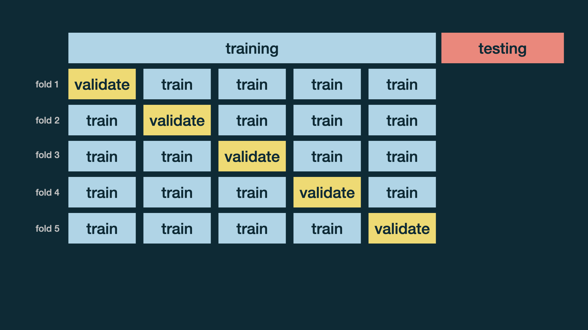
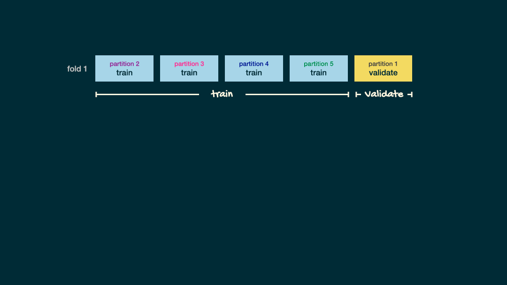
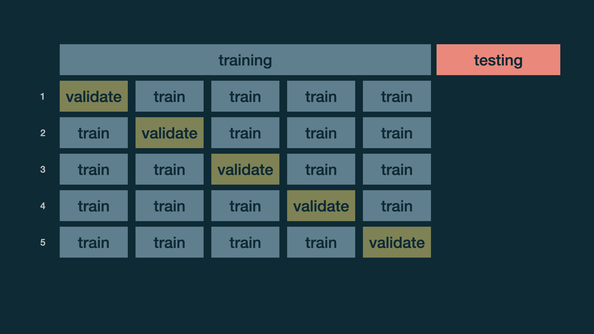

```{r packages, echo = FALSE, message=FALSE, warning=FALSE}
library(tidyverse)
library(magick)
library(dplyr)
library(tidymodels)
library(ggtext)
library(knitr)
library(kableExtra)
library(xaringanExtra)
library(Tmisc)
# library(emo)
library(openintro)
library(ggridges)
library(patchwork)
library(skimr)
library(gghighlight)
set.seed(1234)
options(
  warnPartialMatchArgs = FALSE,
  warnPartialMatchAttr = FALSE, 
  warnPartialMatchDollar = FALSE,
  width = 100
)

xaringanExtra::use_panelset()
```

```{r setup, include=FALSE}
# R options
options(
  htmltools.dir.version = FALSE,
  dplyr.print_min = 6, 
  dplyr.print_max = 6,
  tibble.width = 65,
  width = 65
  )
# figure height, width, dpi
knitr::opts_chunk$set(echo = TRUE, 
                      fig.width = 8, 
                      fig.asp = 0.618,
                      out.width = "60%",
                      fig.align = "center",
                      dpi = 300,
                      message = FALSE)
# ggplot2
ggplot2::theme_set(ggplot2::theme_gray(base_size = 16))
# set seed
set.seed(1234)
# fontawesome
htmltools::tagList(rmarkdown::html_dependency_font_awesome())
# magick
dev.off <- function(){
  invisible(grDevices::dev.off())
}
# output number of lines
hook_output <- knitr::knit_hooks$get("output")
knitr::knit_hooks$set(output = function(x, options) {
  lines <- options$output.lines
  if (is.null(lines)) {
    return(hook_output(x, options))  # pass to default hook
  }
  x <- unlist(strsplit(x, "\n"))
  more <- "..."
  if (length(lines)==1) {        # first n lines
    if (length(x) > lines) {
      # truncate the output, but add ....
      x <- c(head(x, lines), more)
    }
  } else {
    x <- c(more, x[lines], more)
  }
  # paste these lines together
  x <- paste(c(x, ""), collapse = "\n")
  hook_output(x, options)
})

```

layout: true
  
<div class="my-footer">
<span>
University of Edinburgh
</span>
</div> 


---
## Topics

- Building a model for imdb ratings.
- RMSE
- Training set vs test set
- Cross validation
- Extra: model selection
- Extra: automatic model selection

---
class: middle

# Data and exploration

---

background-image: url("img/the-office.jpeg")
class: middle

---

## Data

```{r}
office_ratings <- read_csv("data/office_ratings.csv")
office_ratings
```

.footnote[
.small[
Source: The data come from [data.world](https://data.world/anujjain7/the-office-imdb-ratings-dataset), by way of [TidyTuesday](https://github.com/rfordatascience/tidytuesday/blob/master/data/2020/2020-03-17/readme.md). 
]
]

---

## IMDB ratings

.panelset[
```{r panelset = c(output = "Plot", source = "Code")}
ggplot(office_ratings, aes(x = imdb_rating)) +
  geom_histogram(binwidth = 0.25) +
  labs(
    title = "The Office ratings",
    x = "IMDB Rating"
  )
```
]

---

## IMDB ratings vs. number of votes

.panelset[
```{r panelset = c(output = "Plot", source = "Code"), out.width="55%"}
ggplot(office_ratings, aes(x = total_votes, y = imdb_rating, color = season)) +
  geom_jitter(alpha = 0.7) +
  labs(
    title = "The Office ratings",
    x = "Total votes",
    y = "IMDB Rating",
    color = "Season"
  )
```
]

---

## Outliers

.panelset[
```{r panelset = c(output = "Plot", source = "Code"), out.width="55%"}
ggplot(office_ratings, aes(x = total_votes, y = imdb_rating)) +
  geom_jitter() +
  gghighlight(total_votes > 4000, label_key = title) +
  labs(
    title = "The Office ratings",
    x = "Total votes",
    y = "IMDB Rating"
  )
```
]


---

## IMDB ratings vs. seasons

.panelset[
```{r panelset = c(output = "Plot", source = "Code"), out.width="55%"}
ggplot(office_ratings, aes(x = factor(season), y = imdb_rating, color = season)) +
  geom_boxplot() +
  geom_jitter() +
  guides(color = "none") +
  labs(
    title = "The Office ratings",
    x = "Season",
    y = "IMDB Rating"
  )
```
]

---

class: middle

# Modeling

---

## Train / test

- Create an initial split

```{r}
set.seed(1122)
office_split <- initial_split(office_ratings) # prop = 3/4 by default
```

--
.pull-left[
- Save training data
```{r}
office_train <- training(office_split)
dim(office_train)
```
]

--
.pull-right[
- Save testing data
```{r}
office_test  <- testing(office_split)
dim(office_test)
```
]

---

## Specify model

```{r}
office_mod <- linear_reg() %>%
  set_engine("lm")

office_mod
```

---

## Build recipe

.panelset[
.panel[.panel-name[Code]
```{r}
office_rec <- recipe(imdb_rating ~ ., data = office_train) %>%
  # title isn't a predictor, but keep around to ID
  update_role(title, new_role = "ID") %>%
  # extract month of air_date
  step_date(air_date, features = "month") %>%
  step_rm(air_date) %>%
  # make dummy variables of month 
  step_dummy(contains("month")) %>%
  # remove zero variance predictors
  step_zv(all_predictors())
```
]
.panel[.panel-name[Output]
.small[
```{r}
print(office_rec)
```
]
]
]

---

## Build workflow

.panelset[
.panel[.panel-name[Code]
```{r}
office_wflow <- workflow() %>%
  add_model(office_mod) %>%
  add_recipe(office_rec)
```
]
.panel[.panel-name[Output]
.small[
```{r}
office_wflow
```
]
]
]

---

## Fit model

.panelset[
.panel[.panel-name[Code]
```{r}
office_fit <- office_wflow %>%
  fit(data = office_train)
```
]
.panel[.panel-name[Output]
.small[
```{r}
tidy(office_fit) %>%
  print(n = 12)
```
]
]
]

---

class: middle

# Evaluate model

---

## Make predictions for training data

```{r}
office_train_pred <- predict(office_fit, office_train) %>%
  bind_cols(office_train %>% select(imdb_rating, title))

office_train_pred
```

---

## R-squared

--

Percentage of variability in the IMDB ratings explained by the model

```{r}
rsq(office_train_pred, truth = imdb_rating, estimate = .pred)
```

--

.question[
Are models with high or low $R^2$ more preferable?
]


---

## R-squared

.question[
Are models with high or low $R^2$ more preferable?
]


---

## RMSE

An alternative model performance statistic: **root mean square error**

$$ RMSE = \sqrt{\frac{\sum_{i = 1}^n (y_i - \hat{y}_i)^2}{n}} $$

--

```{r rmse-train}
rmse(office_train_pred, truth = imdb_rating, estimate = .pred)
```

--

.question[
Are models with high or low RMSE are more preferable?
]

---

## RMSE

.question[
Are models with high or low RMSE are more preferable?
]

---

## Interpreting RMSE

.question[
Is this RMSE considered low or high?
]

```{r ref.label="rmse-train"}
```

--

```{r}
office_train %>%
  summarise(min = min(imdb_rating), max = max(imdb_rating))
```

---

class: middle

.hand[
.light-blue[
but, really, who cares about predictions on .pink[training] data?
]
]

---

## Make predictions for testing data

```{r}
office_test_pred <- predict(office_fit, office_test) %>%
  bind_cols(office_test %>% select(imdb_rating, title))

office_test_pred
```

---

## Evaluate performance on testing data

- RMSE of model fit to testing data

```{r}
rmse(office_test_pred, truth = imdb_rating, estimate = .pred)
```

- $R^2$ of model fit to testing data

```{r}
rsq(office_test_pred, truth = imdb_rating, estimate = .pred)
```

---

## Training vs. testing

<br>

```{r echo=FALSE}
rmse_train <- rmse(office_train_pred, truth = imdb_rating, estimate = .pred) %>% 
  pull(.estimate) %>%
  round(3)

rsq_train <- rsq(office_train_pred, truth = imdb_rating, estimate = .pred) %>% 
  pull(.estimate) %>%
  round(3)

rmse_test <- rmse(office_test_pred, truth = imdb_rating, estimate = .pred) %>% 
  pull(.estimate) %>%
  round(3)

rsq_test <- rsq(office_test_pred, truth = imdb_rating, estimate = .pred) %>% 
  pull(.estimate) %>%
  round(3)

tibble(
  data      = c(rep("train", 2), rep("test", 2)),
  estimate  = c(rmse_train, rsq_train, rmse_test, rsq_test),
  metric    = c("RMSE", "R-squared", "RMSE", "R-squared")
) %>%
  pivot_wider(names_from = data, values_from = estimate) %>%
  bind_cols(comparison = c("RMSE lower for training", "R-squared higher for training")) %>%
  kable()
```

.question[
Are we doing better or worse on testing data?
]


---

## Evaluating performance on training data

-  The training set does not have the capacity to be a good arbiter of performance.

--
- It is not an independent piece of information; predicting the training set can only reflect what the model already knows.

--
- Suppose you give a class a test, then give them the answers, then provide the same test. The student scores on the second test do not accurately reflect what they know about the subject; these scores would probably be higher than their results on the first test.

.footnote[
.small[
Source: [tidymodels.org](https://www.tidymodels.org/start/resampling/)
]
]

---

class: middle

# Cross validation

---

## Cross validation

More specifically, **v-fold cross validation**:

- Shuffle your data into v partitions
- Use 1 partition for validation, and the remaining v-1 partitions for training
- Repeat v times

.footnote[
.small[
You might also heard of this referred to as k-fold cross validation.
]
]

---

## Cross validation

```{r echo=FALSE, out.width="100%"}

```

---

## Split data into folds

.pull-left[
```{r}
set.seed(345)

folds <- vfold_cv(office_train, v = 5)
folds
```
]
.pull-right[
```{r echo=FALSE, out.width="100%", fig.align="right"}

```
]

---

## Fit resamples

.pull-left[
```{r}
set.seed(456)

office_fit_rs <- office_wflow %>%
  fit_resamples(folds)

office_fit_rs
```
]
.pull-right[
```{r echo=FALSE, out.width="100%", fig.align="right"}

```
]

---

## Collect CV metrics

```{r}
collect_metrics(office_fit_rs)
```

---

## Deeper look into CV metrics

.panelset[
.panel[.panel-name[Raw]
```{r}
collect_metrics(office_fit_rs, summarize = FALSE) %>%
  print(n = 10)
```
]
.panel[.panel-name[Tidy]
```{r echo=FALSE}
collect_metrics(office_fit_rs, summarize = FALSE) %>%
  select(id, .metric, .estimate) %>%
  pivot_wider(names_from = .metric, values_from = .estimate) %>%
  kable(col.names = c("Fold", "RMSE", "R-squared"), digits = 3)
```
]
]

---

## How does RMSE compare to y?

- Cross validation RMSE stats

```{r echo=FALSE}
collect_metrics(office_fit_rs, summarize = FALSE) %>%
  filter(.metric == "rmse") %>%
  summarise(
    min = min(.estimate),
    max = max(.estimate),
    mean = mean(.estimate),
    med = median(.estimate),
    sd = sd(.estimate),
    IQR = IQR(.estimate)
  )
```

- Training data IMDB score stats

```{r echo=FALSE}
office_train %>%
  summarise(
    min = min(imdb_rating),
    max = max(imdb_rating),
    mean = mean(imdb_rating),
    med = median(imdb_rating),
    sd = sd(imdb_rating),
    IQR = IQR(imdb_rating)
  )
```

---

## What's next?

```{r echo=FALSE, out.width="100%", fig.align="right"}

```

---

class: middle

# Extra: model selection

---

## Which predictors should we keep?

- Our model uses **every** predictor: `season`, `episode`, `total_votes` and 8 dummy variables for the month the episode aired: 11 terms in total

- Adding a predictor **never** lowers $R^2$ on the training data, so $R^2$ on its own always favours the biggest model

- **Occam's razor:** if two models perform about as well, choose the simpler one

- Two ways of comparing models fairly:
  - **Adjusted $R^2$** (on the training data): penalises extra predictors
  - **Cross-validation RMSE**: measures performance on data the model hasn't seen

---

## Candidate models

Each candidate is our recipe with some predictors removed by an extra `step_rm()`

```{r}
candidates <- list(
  "full (+ month)"           = character(0),
  "votes + season + episode" = c("air_date"),
  "votes + season"           = c("episode", "air_date"),
  "votes"                    = c("season", "episode", "air_date")
)
```

- Each entry lists the predictors to **drop**, they will be passed as argument to `step_rm()`
- `character(0)` means drop nothing
- Each variable will enter the code using `starts_with()`, so that `starts_with("air_date")` removes all the month dummies at once (`air_date_month_Feb`, `air_date_month_Mar`, ...)


---

## Fit each candidate

.panelset[
.panel[.panel-name[Code]
```{r}
fit_candidate <- function(drop) {
  wflow <- workflow() %>%
    add_model(office_mod) %>%
    add_recipe(office_rec %>% step_rm(starts_with(drop)))

  train_fit <- fit(wflow, data = office_train)
  cv_fit    <- fit_resamples(wflow, folds)

  tibble(
    n_terms = nrow(tidy(train_fit)) - 1,  # minus the intercept
    adj_rsq = glance(train_fit)$adj.r.squared,
    cv_rmse = collect_metrics(cv_fit) %>%
      filter(.metric == "rmse") %>%
      pull(mean)
  )
}
```
]
.panel[.panel-name[Notes]
- The argument of this function is a vector of variable names to drop from the recipe
- `glance()` gives the adjusted $R^2$ of the model fitted to the training data
- `fit_resamples()` uses the **same** `folds` for every candidate, so the comparison is fair
- The test data is **not** used anywhere
]
]

---

## Compare the candidates

`map` applies `fit_candidate()` to each element of `candidates`, and `list_rbind()` combines the results into a single data frame:

```{r}
model_comparison <- candidates %>%
  map(fit_candidate) %>%
  list_rbind(names_to = "model")

model_comparison
```

--

.question[
Which model would you choose?
]

---

## Occam's razor

```{r echo=FALSE}
model_comparison %>%
  kable(digits = 3, col.names = c("Model", "Terms", "Adjusted R²", "CV RMSE"))
```

<br>

- Adjusted $R^2$ prefers the **full** model
- But the full model's CV RMSE is no better than the model with `total_votes`, `season` and `episode`

--
- The 3-term model predicts new episodes just as well with **8 fewer terms**, so we keep it

---

class: middle

# Extra: automatic model selection

---

## Stepwise selection

With many predictors, trying every combination by hand isn't practical

--

**Backward elimination**
- Start with all predictors
- Try removing each one, and drop the one whose removal gives the lowest CV RMSE
- Repeat until removing any predictor makes CV RMSE worse

--

**Forward selection**
- Start with no predictors
- Try adding each one, and add the one that gives the lowest CV RMSE
- Repeat until adding any predictor makes CV RMSE worse

---

## A helper: CV RMSE for a set of dropped predictors

```{r}
cv_rmse <- function(drop) {
  workflow() %>%
    add_model(office_mod) %>%
    add_recipe(office_rec %>% step_rm(starts_with(drop))) %>%
    fit_resamples(folds) %>%
    collect_metrics() %>%
    filter(.metric == "rmse") %>%
    pull(mean)
}

cv_rmse(character(0))   # full model
cv_rmse("air_date")     # without month
```

---

## Backward elimination

.panelset[
.panel[.panel-name[Code]
.small[
```{r}
vars    <- c("season", "episode", "total_votes", "air_date")
dropped <- character(0)
best    <- cv_rmse(dropped)
history <- tibble()

repeat {
  remaining <- setdiff(vars, dropped)
  if (length(remaining) == 1) break
  # CV RMSE after dropping the previously dropped vars with each remaining predictor
  scores  <- map_dbl(remaining, ~ cv_rmse(c(dropped, .x))) 
  history <- bind_rows(history,
    tibble(round = length(dropped) + 1, drop = remaining, cv_rmse = scores))
  # stop if no removal improves CV RMSE
  if (min(scores) >= best) break
  dropped <- c(dropped, remaining[which.min(scores)])
  best    <- min(scores)
}
```
]
]
.panel[.panel-name[Each round]
```{r}
print(history, n = 7)
```
]
.panel[.panel-name[Result]
```{r}
dropped
best
```
]
]

---

## Forward selection

.panelset[
.panel[.panel-name[Code]
.small[
```{r}
vars    <- c("season", "episode", "total_votes", "air_date")
added <- character(0)
best  <- Inf
history <- tibble()

repeat {
  remaining <- setdiff(vars, added)
  if (length(remaining) == 0) break
  # CV RMSE after adding each remaining predictor
  scores <- map_dbl(remaining, ~ cv_rmse(setdiff(vars, c(added, .x))))
  history <- bind_rows(history,
    tibble(round = length(added) + 1, add = remaining, cv_rmse = scores))
  # stop if no addition improves CV RMSE
  if (min(scores) >= best) break
  added <- c(added, remaining[which.min(scores)])
  best  <- min(scores)
}
```
]
]
.panel[.panel-name[Each round]
.small[
```{r}
print(history, n = 10)
```
]
]
.panel[.panel-name[Result]
```{r}
added
best
```

--

Both directions agree: keep `total_votes`, `season` and `episode`.

]
]


---

## Things to keep in mind

- Stepwise selection is **greedy**: it makes the best single move at each step, so it can miss the best overall combination

- Backward and forward selection don't always agree

- The selection uses only the **training data** (through cross-validation). The test set is used **once**, at the very end

- Base R has a `step()` function that does this automatically, but it uses a different criterion (AIC)

---

## Final model on the test data

.panelset[
.panel[.panel-name[Code]
```{r}
final_fit <- workflow() %>%
  add_model(office_mod) %>%
  add_recipe(office_rec %>% step_rm(starts_with(dropped))) %>%
  last_fit(office_split) # fit the final best model to the training set
```
]
.panel[.panel-name[Test metrics]
```{r}
collect_metrics(final_fit)
```
]
.panel[.panel-name[Coefficients]
```{r}
final_fit %>%
  extract_workflow() %>%
  tidy()
```
]
]

