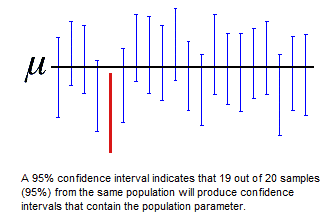

```{r packages, echo = FALSE, message=FALSE, warning=FALSE}
library(tidyverse)
library(magick)
library(dplyr)
library(tidymodels)
library(ggtext)
library(knitr)
library(kableExtra)
library(xaringanExtra)
library(Tmisc)
library(emoji)
library(openintro)
library(ggridges)
library(patchwork)
library(skimr)
library(webshot)
set.seed(1234)
options(
  warnPartialMatchArgs = FALSE,
  warnPartialMatchAttr = FALSE, 
  warnPartialMatchDollar = FALSE,
  width = 100
)

xaringanExtra::use_panelset()

elmhurst_boot <- bootstraps(elmhurst, times = 1000)

```

```{r setup, include=FALSE}
# R options
options(
  htmltools.dir.version = FALSE,
  dplyr.print_min = 6, 
  dplyr.print_max = 6,
  tibble.width = 65,
  width = 65
  )
# figure height, width, dpi
knitr::opts_chunk$set(echo = TRUE, 
                      fig.width = 8, 
                      fig.asp = 0.618,
                      out.width = "60%",
                      fig.align = "center",
                      dpi = 300,
                      message = FALSE)
# ggplot2
ggplot2::theme_set(ggplot2::theme_gray(base_size = 16))
# set seed
set.seed(1234)
# fontawesome
htmltools::tagList(rmarkdown::html_dependency_font_awesome())
# magick
dev.off <- function(){
  invisible(grDevices::dev.off())
}
# output number of lines
hook_output <- knitr::knit_hooks$get("output")
knitr::knit_hooks$set(output = function(x, options) {
  lines <- options$output.lines
  if (is.null(lines)) {
    return(hook_output(x, options))  # pass to default hook
  }
  x <- unlist(strsplit(x, "\n"))
  more <- "..."
  if (length(lines)==1) {        # first n lines
    if (length(x) > lines) {
      # truncate the output, but add ....
      x <- c(head(x, lines), more)
    }
  } else {
    x <- c(more, x[lines], more)
  }
  # paste these lines together
  x <- paste(c(x, ""), collapse = "\n")
  hook_output(x, options)
})

```

layout: true
  
<div class="my-footer">
<span>
University of Edinburgh
</span>
</div> 

---

# Outline

- **Boostrap** for linear regression 
  + Confidence intervals for slopes
  + Similar idea to bootstrapping for means (w4L07)
- Accuracy vs. precision
- **Hypothesis testing**
- p-values
  
---

class: middle

# Boostrap for linear regression

---

# Data

- Family income and gift aid data from a random sample of fifty students in the freshman class of Elmhurst College in Illinois, USA
- Gift aid is financial aid that does not need to be paid back, as opposed to a loan

```{r echo=FALSE, out.width="50%"}
ggplot(elmhurst, aes(x = family_income, y = gift_aid)) +
  geom_point(color = "#8E2C90", size = 2) +
  scale_x_continuous(labels = label_dollar(suffix = "K")) + 
  scale_y_continuous(labels = label_dollar(suffix = "K")) +
  labs(
    x = "Family income",
    y = "Gift aid",
    title = "Gift aid and family income",
    subtitle = "Random sample 50 students at Elmhurst College"
  )
```

.footnote[
.small[
The data come from the openintro package: [`elmhurst`](http://openintrostat.github.io/openintro/reference/elmhurst.html).
]
]

---

## Linear model

.pull-left[
.small[
```{r}
linear_reg() %>%
  set_engine("lm") %>%
  fit(gift_aid ~ family_income, data = elmhurst) %>%
  tidy()
```
]
]
.pull-right[
```{r echo=FALSE, out.width="80%"}
ggplot(elmhurst, aes(x = family_income, y = gift_aid)) +
  geom_point(color = "#8E2C90", size = 2) +
  geom_smooth(method = "lm", se = FALSE, color = "#8E2C90") +
  scale_x_continuous(labels = label_dollar(suffix = "K")) + 
  scale_y_continuous(labels = label_dollar(suffix = "K")) +
  labs(
    x = "Family income",
    y = "Gift aid",
    title = "Gift aid and family income",
    subtitle = "Random sample 50 students at Elmhurst College"
  )
```
]


**Interpreting the slope:** 
For each additional $1,000 of family income, we would expect students to receive 1,000 * 0.0431 = $43.10 less in gift aid on average.


.question[
Is it exactly $43.10 for all students at this school?
]

---

```{r echo=FALSE}
elmhurst_fit <- linear_reg() %>%
  set_engine("lm") %>%
  fit(gift_aid ~ family_income, data = elmhurst) %>%
  tidy() 

elmhurst_slope_obs <- elmhurst_fit %>%
  filter(term == "family_income") %>%
  pull(estimate) %>%
  round(4)
```

## Observed sample

```{r echo=FALSE}
ggplot(elmhurst, aes(x = family_income, y = gift_aid)) +
  geom_point(color = "#8E2C90", size = 2) +
  geom_smooth(method = "lm", se = FALSE, color = "#8E2C90") +
  scale_x_continuous(labels = label_dollar(suffix = "K"), limits = c(0, 275)) + 
  scale_y_continuous(labels = label_dollar(suffix = "K"), limits = c(0, 42)) +
  annotate("text", x = 200, y = 40, label = paste("slope =", elmhurst_slope_obs), size = 6, hjust = 0)  +
  labs(
    x = "Family income",
    y = "Gift aid",
    title = "Gift aid and family income",
    subtitle = "Random sample 50 students at Elmhurst College"
  )
```

---

## Bootstrap population

```{r echo=FALSE, warning=FALSE}
elmhurst_boot %>% 
  slice_head(n = 50) %>%
  mutate(data = map(splits, "data")) %>%
  select(-1) %>% 
 # hoist(data, "data") %>% 
  unnest(data) %>% 
  ggplot(aes(x = family_income, y = gift_aid)) +
  geom_jitter(alpha = 0.11, width = 30, height = 10) +
  geom_point(data = elmhurst, mapping = aes(x = family_income, y = gift_aid), color = "#8E2C90", size = 2) +
  scale_x_continuous(labels = label_dollar(suffix = "K"), limits = c(0, 275)) + 
  scale_y_continuous(labels = label_dollar(suffix = "K"), limits = c(0, 42)) +
  annotate("text", x = 200, y = 40, label = paste("slope = ?"), size = 6, hjust = 0)  +
  labs(
    x = "Family income",
    y = "Gift aid",
    title = "Gift aid and family income",
    subtitle = "(Simulated) population of students at Elmhurst College"
  )
```

Generated assuming there are more students like the ones in the observed sample...

---

# Goal: Confidence Interval for the Slope

- We want to quantify the **range of plausible values** for the true slope in the population.

- We will use **bootstrapping** to create a confidence interval for the slope.

---

# Bootstrapping Regression: Step-By-Step

1. Take a bootstrap sample - a random sample taken **with replacement** from the 
original sample, of the same size as the original sample
2. Calculate the bootstrap statistic. In regression model, fit a new regression model for each bootstrap sample to obtain the slope
3. Repeat steps (1) and (2) many times to create a bootstrap distribution - 
a distribution of bootstrap statistics
4. Calculate the bounds of the XX% confidence interval as the middle XX% 
of the bootstrap distribution

---

## Bootstrap sample 1

```{r}
elmhurtst_boot_1 <- elmhurst %>%
  slice_sample(n = 50, replace = TRUE)
```


```{r echo=FALSE}
elmhurtst_boot_1_slope <- linear_reg() %>%
  set_engine("lm") %>%
  fit(gift_aid ~ family_income, data = elmhurtst_boot_1) %>%
  tidy() %>%
  filter(term == "family_income") %>%
  pull(estimate) %>%
  round(4)

ggplot(elmhurtst_boot_1, aes(x = family_income, y = gift_aid)) +
  geom_point(color = "#E48957", size = 2, alpha = 0.8) +
  geom_smooth(method = "lm", se = FALSE, color = "#E48957") +
  scale_x_continuous(labels = label_dollar(suffix = "K"), limits = c(0, 275)) + 
  scale_y_continuous(labels = label_dollar(suffix = "K"), limits = c(0, 42)) +
  annotate("text", x = 200, y = 40, label = paste("slope =", elmhurtst_boot_1_slope), size = 6, hjust = 0) +
  labs(
    x = "Family income",
    y = "Gift aid",
    title = "Bootstrap sample 1"
  )
```

---

## Bootstrap sample 2

```{r}
elmhurtst_boot_2 <- elmhurst %>%
  slice_sample(n = 50, replace = TRUE)
```


```{r echo=FALSE}
elmhurtst_boot_2_slope <- linear_reg() %>%
  set_engine("lm") %>%
  fit(gift_aid ~ family_income, data = elmhurtst_boot_2) %>%
  tidy() %>%
  filter(term == "family_income") %>%
  pull(estimate) %>%
  round(4)

ggplot(elmhurtst_boot_2, aes(x = family_income, y = gift_aid)) +
  geom_point(color = "#260b27", size = 2, alpha = 0.8) +
  geom_smooth(method = "lm", se = FALSE, color = "#260b27") +
  scale_x_continuous(labels = label_dollar(suffix = "K"), limits = c(0, 275)) + 
  scale_y_continuous(labels = label_dollar(suffix = "K"), limits = c(0, 42)) +
  annotate("text", x = 200, y = 40, label = paste("slope =", elmhurtst_boot_2_slope), size = 6, hjust = 0) +
  labs(
    x = "Family income",
    y = "Gift aid",
    title = "Bootstrap sample 2"
  )
```

---

## Bootstrap sample 3

```{r}
elmhurtst_boot_3 <- elmhurst %>%
  slice_sample(n = 50, replace = TRUE)
```


```{r echo=FALSE}
elmhurtst_boot_3_slope <- linear_reg() %>%
  set_engine("lm") %>%
  fit(gift_aid ~ family_income, data = elmhurtst_boot_3) %>%
  tidy() %>%
  filter(term == "family_income") %>%
  pull(estimate) %>%
  round(4)

ggplot(elmhurtst_boot_3, aes(x = family_income, y = gift_aid)) +
  geom_point(color = "#e6b0e7", size = 2, alpha = 0.8) +
  geom_smooth(method = "lm", se = FALSE, color = "#e6b0e7") +
  scale_x_continuous(labels = label_dollar(suffix = "K"), limits = c(0, 275)) + 
  scale_y_continuous(labels = label_dollar(suffix = "K"), limits = c(0, 42)) +
  annotate("text", x = 200, y = 40, label = paste("slope =", elmhurtst_boot_3_slope), size = 6, hjust = 0) +
  labs(
    x = "Family income",
    y = "Gift aid",
    title = "Bootstrap sample 3"
  )
```

---

## Bootstrap sample 4

```{r}
elmhurtst_boot_4 <- elmhurst %>%
  slice_sample(n = 50, replace = TRUE)
```


```{r echo=FALSE}
elmhurtst_boot_4_slope <- linear_reg() %>%
  set_engine("lm") %>%
  fit(gift_aid ~ family_income, data = elmhurtst_boot_4) %>%
  tidy() %>%
  filter(term == "family_income") %>%
  pull(estimate) %>%
  round(4)

ggplot(elmhurtst_boot_4, aes(x = family_income, y = gift_aid)) +
  geom_point(color = "orange", size = 2, alpha = 0.8) +
  geom_smooth(method = "lm", se = FALSE, color = "orange") +
  scale_x_continuous(labels = label_dollar(suffix = "K"), limits = c(0, 275)) + 
  scale_y_continuous(labels = label_dollar(suffix = "K"), limits = c(0, 42)) +
  annotate("text", x = 200, y = 40, label = paste("slope =", elmhurtst_boot_4_slope), size = 6, hjust = 0) +
  labs(
    x = "Family income",
    y = "Gift aid",
    title = "Bootstrap sample 4"
  )
```

---

## Bootstrap samples 1 - 4

```{r echo=FALSE}
ggplot() +
  geom_point(data = elmhurtst_boot_1, aes(x = family_income, y = gift_aid), color = "#E48957") +
  geom_smooth(data = elmhurtst_boot_1, aes(x = family_income, y = gift_aid), method = "lm", se = FALSE, color = "#E48957") +
  geom_point(data = elmhurtst_boot_2, aes(x = family_income, y = gift_aid), color = "#260b27") +
  geom_smooth(data = elmhurtst_boot_2, aes(x = family_income, y = gift_aid), method = "lm", se = FALSE, color = "#260b27") +
  geom_point(data = elmhurtst_boot_3, aes(x = family_income, y = gift_aid), color = "#e6b0e7") +
  geom_smooth(data = elmhurtst_boot_3, aes(x = family_income, y = gift_aid), method = "lm", se = FALSE, color = "#e6b0e7") +
  geom_point(data = elmhurtst_boot_4, aes(x = family_income, y = gift_aid), color = "orange") +
  geom_smooth(data = elmhurtst_boot_4, aes(x = family_income, y = gift_aid), method = "lm", se = FALSE, color = "orange") +
  scale_x_continuous(labels = label_dollar(suffix = "K")) + 
  scale_y_continuous(labels = label_dollar(suffix = "K")) +
  labs(
    x = "Family income",
    y = "Gift aid",
    title = "Bootstrap samples"
  )
```

---

## Many many samples...

```{r echo=FALSE}
elmhurst_models <- elmhurst_boot %>%
  mutate(
    model = map(splits, ~ lm(gift_aid ~ family_income, data = .)),
    coef_info = map(model, tidy)
  )

elmhurst_coefs <- elmhurst_models %>%
  unnest(coef_info)

elmhurst_aug <- elmhurst_models %>%
  slice_sample(n = 200) %>%
  mutate(augmented = map(model, augment)) %>%
  unnest(augmented)

ggplot(elmhurst_aug, aes(x = family_income, y = gift_aid)) +
  geom_line(aes(y = .fitted, group = id), alpha = 0.5, col = "gray") +
  geom_point(color = "#8E2C90") +
  scale_x_continuous(labels = label_dollar(suffix = "K"), limits = c(0, 275)) + 
  scale_y_continuous(labels = label_dollar(suffix = "K"), limits = c(0, 42)) +
  labs(
    x = "Family income",
    y = "Gift aid",
    title = "Bootstrap samples"
  )
```

---

## Code

```{r eval=FALSE}
library(tidyverse)
library(rsample)
library(broom)
set.seed(1234)

# take 1000 bootstrap samples
elmhurst_boot <- bootstraps(elmhurst, times = 1000)

# for each sample
# fit a model and save output in model column
# tidy model output and save in coef_info column 
elmhurst_models <- elmhurst_boot %>%
  mutate(
    model = map(splits, ~ lm(gift_aid ~ family_income, data = .)),
    coef_info = map(model, tidy)
  )

# unnest coef_info (for intercept and slope)
elmhurst_coefs <- elmhurst_models %>% unnest(coef_info)

# calculate 95% (default) percentile interval
int_pctl(elmhurst_models, coef_info)
```

---

## Slopes of bootstrap samples

```{r out.width="50%"}
elmhurst_coefs %>%
  filter(term == "family_income") %>%
  ggplot(aes(estimate)) +
  geom_histogram(binwidth = 0.0025, alpha = 0.7, fill = "gray") +
  labs(title = "Slopes of bootstrap samples")
```

---

## 95% confidence interval

```{r echo=FALSE}
intervals <- int_pctl(elmhurst_models, coef_info) %>%
  filter(term == "family_income")

elmhurst_coefs %>%
  filter(term == "family_income") %>%
  ggplot(aes(estimate)) +
  geom_histogram(binwidth = 0.0025, alpha = 0.7, fill = "gray") +
  labs(title = "Distribution of slopes of bootstrap samples") +
  geom_segment( data = data.frame(xst = intervals %>% pull(.lower), 
                                  xed = intervals %>% pull(.lower), 
                                  yst = 0,
                                  yed = 25),
    mapping = aes(x = xst, xend = xed, y = yst, yend = yed),
    linetype = "dashed"
  ) +
  annotate("text", x = intervals %>% pull(.lower), y = 30, 
           label = as.character(intervals %>% pull(.lower) %>% round(4)), size = 6) +
  geom_segment( data = data.frame(xst = intervals %>% pull(.upper), 
                                  xed = intervals %>% pull(.upper), 
                                  yst = 0,
                                  yed = 25),
    mapping = aes(x = xst, xend = xed, y = yst, yend = yed),
    linetype = "dashed"
  ) +
  annotate("text", x = intervals %>% pull(.upper), y = 30, 
           label = as.character(intervals %>% pull(.upper) %>% round(4)), size = 6) +
  geom_segment( data = data.frame(xst = elmhurst_slope_obs, 
                                  xed = elmhurst_slope_obs, 
                                  yst = 0,
                                  yed = 25),
    mapping = aes(x = xst, xend = xed, y = yst, yend = yed),
    colour = "#8E2C90",
    linetype = "dashed"
  ) +
  annotate("text", x = elmhurst_slope_obs, y = 30,
    label = as.character(elmhurst_slope_obs), size = 6, color = "#8E2C90"
  )
```

---

## Interpreting the slope, take two

```{r}
int_pctl(elmhurst_models, coef_info)
```

**We are 95% confident that** for each additional $1,000 of family income, we would expect students to receive between $21.90 and $69.50 less in gift aid, on average.

---

class: middle

# Accuracy vs. precision

---

## Confidence level

**We are 95% confident that ...**

- Suppose we took many samples from the original population and built a 95% confidence interval for the slope based on each sample.
- Then about 95% of those intervals would contain the true population slope.

--

```{r echo=FALSE, out.width="30%"}

```

.footnote[
.small[
Source: Minitab blog [Understanding Hypothesis Tests: Confidence Intervals and Confidence Levels](https://blog.minitab.com/en/adventures-in-statistics-2/understanding-hypothesis-tests-confidence-intervals-and-confidence-levels), 22 Nov 2023.
]
]

---

## Commonly used confidence levels

.question[
Which line represents which confidence level? (between 99%, 95% and 90% confidence).
]

```{r echo=FALSE}
elmhurst_slopes <- elmhurst_coefs %>%
  filter(term == "family_income")

l90 <- quantile(elmhurst_slopes$estimate, 0.05)
u90 <- quantile(elmhurst_slopes$estimate, 0.95)

l95 <- quantile(elmhurst_slopes$estimate, 0.025)
u95 <- quantile(elmhurst_slopes$estimate, 0.975)

l99 <- quantile(elmhurst_slopes$estimate, 0.005)
u99 <- quantile(elmhurst_slopes$estimate, 0.995)

ggplot(data = elmhurst_slopes, mapping = aes(x = estimate)) +
  geom_histogram(binwidth = 0.0025, fill = "gray", alpha = 0.7) +
  geom_vline(xintercept = c(l95, u95), color = "#A7D5E8", lty = 2, linewidth = 2) +
  geom_vline(xintercept = c(l90, u90), color = "chartreuse4", lty = 3, linewidth = 2) +
  geom_vline(xintercept = c(l99, u99), color = "orange", lty = 6, linewidth = 2) +
  labs(title = "Slopes of bootstrap samples",
       subtitle = "and various confidence intervals",
       x = "Slope")
```

---

## Precision vs. accuracy

.question[
If we want to be very certain that we capture the population slope, should we use a wider or a narrower interval? What drawbacks are associated with using a wider interval?
]

--

```{r echo=FALSE, out.width="60%"}

```


---

## Changing confidence level

How to get a 90% or 99% confidence interval for the slope?

.small[
*Hint:* look at the `alpha` argument in `?int_pctl`. By default `alpha = 0.05`, which gives a 95% interval.
]

```{r eval=FALSE}
alpha <- 0.10
int_pctl(elmhurst_models, coef_info, alpha = alpha)
```

Or, equivalently, starting from the bootstrap slopes:

```{r eval=FALSE}
elmhurst_coefs %>%
  filter(term == "family_income") %>%
  summarize(lower = quantile(estimate, alpha/2),
            upper = quantile(estimate, 1-(alpha/2) ))
```

---

class: middle

# Hypothesis testing

---

## Two kinds of questions

- **Confidence interval:** *What is a plausible range of values for the slope?*
  - This is what we just did with bootstrapping

- **Hypothesis test:** *Is there any relationship at all, or could the pattern we see just be due to chance?*

--

- Remember week 4: the confidence interval for the difference in proportions of the diabetes drugs did not contain 0, so we concluded that the two drugs were likely not equally effective

- Today we formalise this idea with a **hypothesis test**

---

## A courtroom analogy `r emoji::emoji("balance_scale")`

- A defendant is **presumed innocent** until proven guilty
- The prosecution brings **evidence**
- The jury asks: *is the evidence strong enough to reject the idea that the defendant is innocent?*

--

In statistics:

- **Null hypothesis** $(H_0)$: "nothing is going on" (innocent)
- **Alternative hypothesis** $(H_A)$: "something is going on" (guilty)


- The jury's verdict is either "guilty" or "not guilty", never "innocent"
- Similarly, we either **reject** $H_0$ or **fail to reject** $H_0$: we never "prove" $H_0$

---

## Hypotheses for the Elmhurst data

```{r echo=FALSE}
elmhurst_slope_obs_ht <- linear_reg() %>%
  set_engine("lm") %>%
  fit(gift_aid ~ family_income, data = elmhurst) %>%
  tidy() %>%
  filter(term == "family_income") %>%
  pull(estimate) %>%
  round(4)
```

- $H_0: \beta_1 = 0$: there is **no** relationship between family income and gift aid
- $H_A: \beta_1 \neq 0$: there **is** a relationship between family income and gift aid

--

<br>

- Observed slope in our sample: **`r elmhurst_slope_obs_ht`**

.question[
If $H_0$ were true, how surprising would it be to observe a slope of `r elmhurst_slope_obs_ht` just by chance?
]


To answer this, we need to know what slopes look like **in a world where $H_0$ is true**.

---

class: middle

# Simulating a world where the null hypothesis is true

---

## Bootstrap vs. permutation

.pull-left[
**Bootstrap** (for confidence intervals)

- Resample **rows** with replacement
- Each `family_income` stays with its own `gift_aid`
- The relationship in the data is **kept**
- Tells us how much the slope **varies** from sample to sample
]
.pull-right[
**Permutation** (for hypothesis tests)

- **Shuffle** the `gift_aid` values across students
- Each `family_income` gets a random `gift_aid`
- Any relationship in the data is **broken**
- Simulates a world where $H_0$ **is true**
]

---

## Shuffling: an illustration

```{r echo=FALSE}
set.seed(2025)
```

.pull-left[
Original data (first 6 students)

```{r echo=FALSE}
elmhurst_small <- elmhurst %>%
  slice_head(n = 6) %>%
  select(family_income, gift_aid)
elmhurst_small
```
]
.pull-right[
`gift_aid` shuffled

```{r echo=FALSE}
elmhurst_small %>%
  mutate(gift_aid = sample(gift_aid))
```
]

<br>

The values of `gift_aid` are the same, but they are now assigned to students **at random**: family income can no longer tell us anything about gift aid.

---

```{r echo=FALSE}
perm_color1 <- "#E48957"
perm_color2 <- "#260b27"
perm_color3 <- "orange"

perm_slope <- function(data) {
  linear_reg() %>%
    set_engine("lm") %>%
    fit(gift_aid ~ family_income, data = data) %>%
    tidy() %>%
    filter(term == "family_income") %>%
    pull(estimate) %>%
    round(4)
}
```

## Permuted sample 1

```{r}
elmhurst_perm_1 <- elmhurst %>%
  mutate(gift_aid = sample(gift_aid))
```

```{r echo=FALSE}
ggplot(elmhurst_perm_1, aes(x = family_income, y = gift_aid)) +
  geom_point(color = perm_color1, size = 2, alpha = 0.8) +
  geom_smooth(method = "lm", se = FALSE, color = perm_color1) +
  scale_x_continuous(labels = label_dollar(suffix = "K"), limits = c(0, 275)) +
  scale_y_continuous(labels = label_dollar(suffix = "K"), limits = c(0, 42)) +
  annotate("text", x = 200, y = 40, label = paste("slope =", perm_slope(elmhurst_perm_1)), size = 6, hjust = 0) +
  labs(
    x = "Family income",
    y = "Gift aid",
    title = "Permuted sample 1"
  )
```

---

## Permuted sample 2

```{r}
elmhurst_perm_2 <- elmhurst %>%
  mutate(gift_aid = sample(gift_aid))
```

```{r echo=FALSE}
ggplot(elmhurst_perm_2, aes(x = family_income, y = gift_aid)) +
  geom_point(color = perm_color2, size = 2, alpha = 0.8) +
  geom_smooth(method = "lm", se = FALSE, color = perm_color2) +
  scale_x_continuous(labels = label_dollar(suffix = "K"), limits = c(0, 275)) +
  scale_y_continuous(labels = label_dollar(suffix = "K"), limits = c(0, 42)) +
  annotate("text", x = 200, y = 40, label = paste("slope =", perm_slope(elmhurst_perm_2)), size = 6, hjust = 0) +
  labs(
    x = "Family income",
    y = "Gift aid",
    title = "Permuted sample 2"
  )
```

---

## Permuted sample 3

```{r}
elmhurst_perm_3 <- elmhurst %>%
  mutate(gift_aid = sample(gift_aid))
```

```{r echo=FALSE}
ggplot(elmhurst_perm_3, aes(x = family_income, y = gift_aid)) +
  geom_point(color = perm_color3, size = 2, alpha = 0.8) +
  geom_smooth(method = "lm", se = FALSE, color = perm_color3) +
  scale_x_continuous(labels = label_dollar(suffix = "K"), limits = c(0, 275)) +
  scale_y_continuous(labels = label_dollar(suffix = "K"), limits = c(0, 42)) +
  annotate("text", x = 200, y = 40, label = paste("slope =", perm_slope(elmhurst_perm_3)), size = 6, hjust = 0) +
  labs(
    x = "Family income",
    y = "Gift aid",
    title = "Permuted sample 3"
  )
```

---

## Many many permuted samples...

```{r echo=FALSE}
set.seed(1234)
perm_lines <- map_dfr(1:200, function(i) {
  perm <- elmhurst %>% mutate(gift_aid = sample(gift_aid))
  fit <- lm(gift_aid ~ family_income, data = perm)
  tibble(rep = i, intercept = coef(fit)[1], slope = coef(fit)[2])
})

ggplot(elmhurst, aes(x = family_income, y = gift_aid)) +
  geom_abline(data = perm_lines,
              aes(intercept = intercept, slope = slope),
              color = "gray", alpha = 0.4) +
  geom_point(color = "#8E2C90", size = 2) +
  geom_smooth(method = "lm", se = FALSE, color = "#8E2C90", linewidth = 1.5) +
  scale_x_continuous(labels = label_dollar(suffix = "K"), limits = c(0, 275)) +
  scale_y_continuous(labels = label_dollar(suffix = "K"), limits = c(0, 42)) +
  labs(
    x = "Family income",
    y = "Gift aid",
    title = "Fitted lines from 200 permuted samples (gray)",
    subtitle = "and the fitted line from the observed sample (purple)"
  )
```

---

## The null distribution

```{r echo=FALSE}
set.seed(1234)
null_dist <- elmhurst %>%
  specify(gift_aid ~ family_income) %>%
  hypothesize(null = "independence") %>%
  generate(reps = 1000, type = "permute") %>%
  calculate(stat = "slope")

obs_slope <- elmhurst %>%
  specify(gift_aid ~ family_income) %>%
  calculate(stat = "slope")
```

The distribution of slopes from 1000 permuted samples: what slopes look like **if $H_0$ is true**.

```{r echo=FALSE, out.width="55%"}
ggplot(null_dist, aes(x = stat)) +
  geom_histogram(binwidth = 0.0025, fill = "gray", alpha = 0.9) +
  geom_vline(xintercept = obs_slope$stat, color = "#8E2C90", lty = 2, linewidth = 1) +
  annotate("text", x = obs_slope$stat, y = 90,
           label = paste("observed\nslope =", round(obs_slope$stat, 4)),
           size = 5, color = "#8E2C90", hjust = -0.1) +
  labs(title = "Null distribution of slopes", x = "Slope")
```

The null distribution is centred at 0 and our observed slope is **far out in the tail**.

---

class: middle

# p-values

---

## What is a p-value?

.pull-left[
The **p-value** is the probability of observing a result **at least as extreme** as ours, **if the null hypothesis were true**.

<br>

In a simulation: the **proportion of permuted samples** whose slope is at least as far from 0 as the observed slope.

<br>

The shaded areas on the right show the p-value for a *hypothetical* observed slope (red line).
]
.pull-right[
```{r echo=FALSE, out.width="100%", warning=FALSE}
hyp_slope <- quantile(null_dist$stat, 0.04)
hyp_p <- null_dist %>%
  get_p_value(obs_stat = hyp_slope, direction = "two-sided") %>%
  pull()

visualize(null_dist) +
  shade_p_value(obs_stat = hyp_slope, direction = "two-sided") +
  labs(
    title = "Hypothetical example",
    subtitle = paste("p-value =", round(hyp_p, 3)),
    x = "Slope"
  )
```
]

---

## Reading a p-value

- **Small p-value:** data like ours would be **surprising** if $H_0$ were true, which is evidence **against** $H_0$

- **Large p-value:** data like ours are the kind of thing that **chance alone** produces often, so there is not enough evidence against $H_0$

--

<br>

**Decision rule:** we choose a **significance level** $\alpha$ in advance, usually $\alpha = 0.05$

- If p-value $< \alpha$: **reject** $H_0$
- If p-value $\geq \alpha$: **fail to reject** $H_0$

--

.question[
But why 0.05? And can our decision be wrong?
]

---

## Decision errors

Whatever we decide, we might be wrong:

<br>

|                         | ** $H_0$ is true **          | ** $H_A$ is true **           |
|:------------------------|:--------------------------:|:---------------------------:|
| **Reject $H_0$**        | ❌ **Type 1 error**         | ✅ Correct decision          |
| **Do not reject $H_0$** | ✅ Correct decision         | ❌ **Type 2 error**          |


- **Type 1 error:** rejecting $H_0$ when it is actually true (a **false positive**)
  - Courtroom: convicting an innocent defendant
- **Type 2 error:** not rejecting $H_0$ when $H_A$ is actually true (a **false negative**)
  - Courtroom: letting a guilty defendant go free

---

## The significance level $\alpha$

- The significance level $\alpha$ is the **maximum probability of a Type 1 error** that we are willing to accept

--

- If $H_0$ is true, the p-value is smaller than 0.05 only about 5% of the time
  - So rejecting $H_0$ when p-value $< 0.05$ means we will wrongly reject a true $H_0$ in **at most 5%** of studies

--

- $\alpha = 0.05$ is a **convention**, not a law of nature
  - In the courtroom we want to be very sure before convicting, so we keep the probability of a Type 1 error low

--

- **Trade-off:** making $\alpha$ smaller (e.g. 0.01) makes Type 1 errors less likely but Type 2 errors **more** likely: we are harder to convince, so we miss more real effects

---

## What a p-value is NOT

.question[
Which of these statements are correct? **TPSA**
]


- ❌ The p-value is the probability that $H_0$ is true


- ❌ The p-value is the probability that the result is due to chance


- ❌ A small p-value means the effect is large or important
  - The p-value tells us about evidence, not size: use the **confidence interval** for the size of the effect


- ❌ p-value = 0.049 and p-value = 0.051 give very different evidence
  - They are almost the same amount of evidence, even if they lead to different decisions at $\alpha = 0.05$


- ✅ The p-value is the probability of data at least as extreme as ours, **assuming $H_0$ is true**

---

class: middle

# Hypothesis testing with tidymodels

---

## Generate the null distribution

```{r eval=FALSE}
library(infer)
set.seed(1234)

null_dist <- elmhurst %>%
  # specify the relationship of interest
  specify(gift_aid ~ family_income) %>%
  # state the null hypothesis: no relationship
  hypothesize(null = "independence") %>% #<<
  # generate 1000 permuted samples
  generate(reps = 1000, type = "permute") %>% #<<
  # calculate the slope for each permuted sample
  calculate(stat = "slope")
```

<br>

Compare with the bootstrap code from week 4:

- **New:** `hypothesize()` states the null hypothesis
- **Changed:** `type = "permute"` instead of `type = "bootstrap"`

---

## Calculate the observed slope and the p-value

```{r}
obs_slope <- elmhurst %>%
  specify(gift_aid ~ family_income) %>%
  calculate(stat = "slope")
null_dist %>%
  get_p_value(obs_stat = obs_slope, direction = "two-sided")
```

--

- None of the 1000 permuted slopes was as extreme as the observed one
- The p-value is never exactly 0: it is **very small**, so we report it as **p-value < 0.001**

---

## Visualise the p-value

```{r out.width="55%", warning=FALSE}
visualize(null_dist) +
  shade_p_value(obs_stat = obs_slope, direction = "two-sided")
```

The observed slope is so extreme that the shaded area is not visible.

---

## Conclusion

- p-value < 0.001, which is smaller than $\alpha = 0.05$, so we **reject $H_0$**

- **In context:** the data provide convincing evidence of a relationship between family income and gift aid for students at Elmhurst College

- **Caution:** this is an observational study, so this does not mean that family income **causes** the difference in gift aid

---

## Confidence intervals and hypothesis tests

- 95% confidence interval for the slope: (-0.0695, -0.0219)
- The interval does **not contain 0**, which agrees with rejecting $H_0: \beta_1 = 0$ at $\alpha = 0.05$

--

<br>

They answer complementary questions:

- **Hypothesis test:** *Is there evidence of a relationship?*
- **Confidence interval:** *How large is the relationship?*

--

Good practice: **report both**.

---

## Summary

- **Bootstrap** (resample rows) → **confidence interval**: a plausible range for the population parameter

- **Permutation** (shuffle the response) → **null distribution**: what the statistic looks like if $H_0$ is true

- **p-value:** the probability of a result at least as extreme as ours, if $H_0$ were true

- **Decision:** reject $H_0$ if p-value $< \alpha$, where $\alpha$ is the maximum probability of a Type 1 error that we accept (usually 0.05)

- **Errors:** Type 1 = rejecting a true $H_0$; Type 2 = not rejecting a false $H_0$

---

## Recap 

- Sample statistic $\ne$ population parameter, but if the sample is good, it can be a good estimate
- We report the estimate with a confidence interval, and the width of this interval depends on the variability of sample statistics from different samples from the population
- Since we can't continue sampling from the population, we bootstrap from the one sample we have to estimate sampling variability
- We can do this for any sample statistic:
  - For a mean: `calculate(stat = "mean")`
  - Learn about calculating bootstrap intervals for other statistics in the quiz

